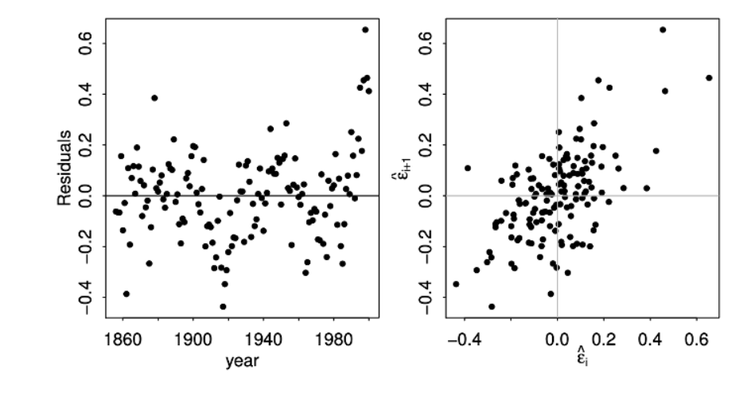
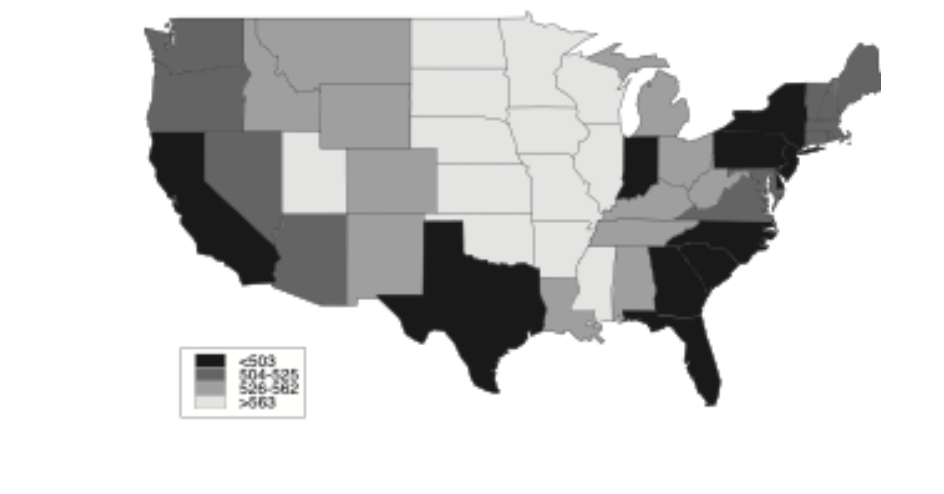
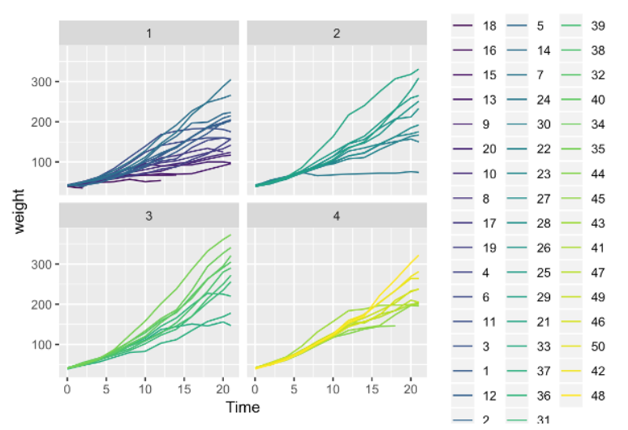
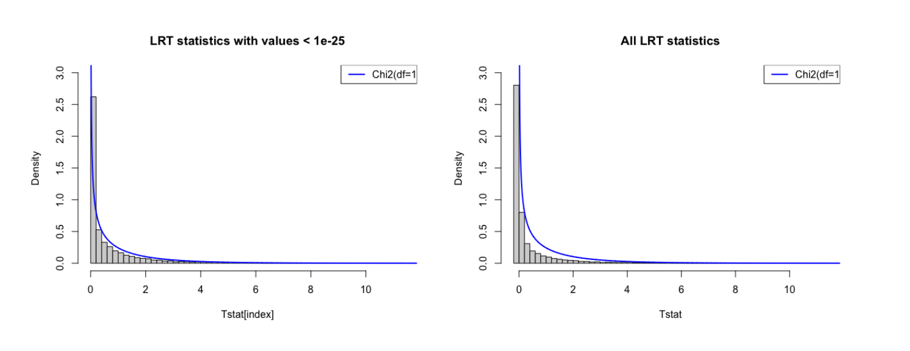
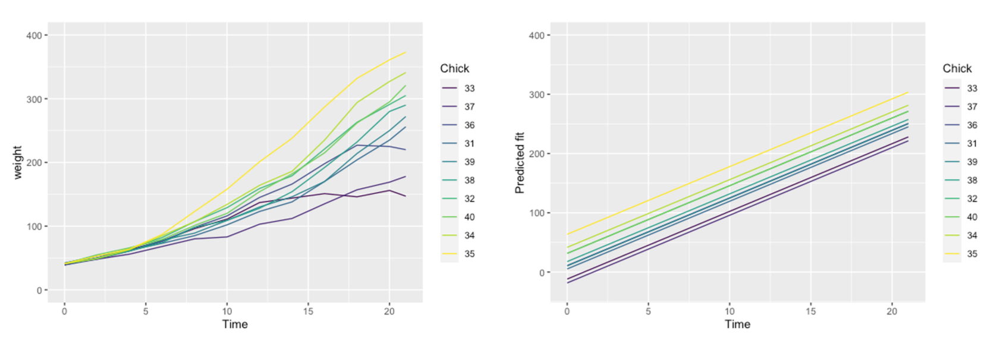
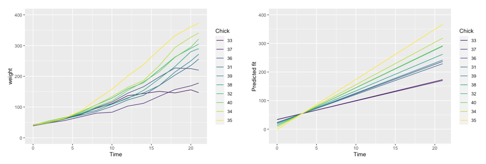
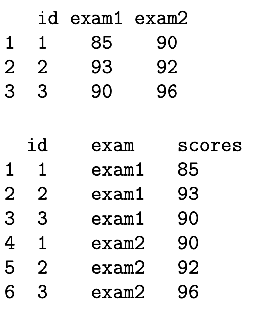
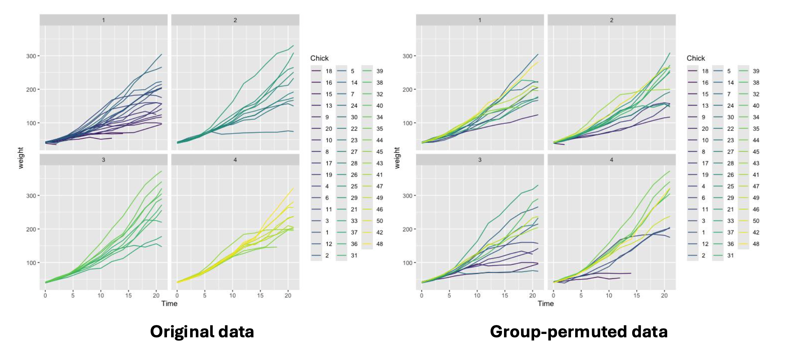

## Table of Contents

- Examples of correlated data
- Generalized least squares
- Random effects modeling
- Statistical inference
- Longitudinal data analysis

# Examples of correlated data

## Where are we so far?

- Starting with linear model, could we relax assumptions and still be able to derive efficient estimators?

## Examples of Correlated Data: Temporal Data

- The issue of global warming has attracted significant interest in recent years. Reliable records of annual temperatures taken with thermometers are only available back to the 1850s. We can build a linear model to predict temperature since 1856 and then subsequently use this to predict earlier temperatures based on proxy information.

{fig-align="center" width="60%"}

## Examples of Correlated Data: Spatial Data

- The statewide average of the SAT verbal exam scores are reported by College Board and the map of the raw data shows spatial pattern.

{fig-align="center" width="60%"}

## Examples of Correlated Data: Repeated Measures

- 48 chicks at birth are assigned to four different diets and their weights were observed every 2 weeks until 21 weeks.
- We are interested in whether the effects of diets on the weight gain over time is the same.
- Measurements made on the same chick are likely to be correlated.
  - (within-subject correlation)

{fig-align="center" width="60%"}


## Covariance Matrix

- In (simple and multiple) linear regression, we assumed that the noises are normally distributed and independent. In other words,

$$
\operatorname{Cov}(\epsilon_i,\epsilon_j)=\operatorname{Cov}(\epsilon_j,\epsilon_i)=0\quad\text{for all subjects }i\text{ and }j
$$

- The covariance can be computed for all pairs of subjects, which may be stacked in a form of matrix:

$$
\operatorname{Cov}\begin{pmatrix}\epsilon_1\\\epsilon_2\\\vdots\\\epsilon_n\end{pmatrix}=\begin{bmatrix}\operatorname{Var}(\epsilon_1)&\operatorname{Cov}(\epsilon_1,\epsilon_2)&\cdots&\operatorname{Cov}(\epsilon_1,\epsilon_n)\\\operatorname{Cov}(\epsilon_2,\epsilon_1)&\operatorname{Var}(\epsilon_2)&\cdots&\operatorname{Cov}(\epsilon_2,\epsilon_n)\\\vdots&\vdots&\ddots&\vdots\\\operatorname{Cov}(\epsilon_n,\epsilon_1)&\operatorname{Cov}(\epsilon_n,\epsilon_2)&\cdots&\operatorname{Var}(\epsilon_n)\end{bmatrix}
$$

## Covariance Matrix

$$
\operatorname{Cov}\begin{pmatrix}\epsilon_1\\\epsilon_2\\\vdots\\\epsilon_n\end{pmatrix}=\begin{bmatrix}\operatorname{Var}(\epsilon_1)&\operatorname{Cov}(\epsilon_1,\epsilon_2)&\cdots&\operatorname{Cov}(\epsilon_1,\epsilon_n)\\\operatorname{Cov}(\epsilon_2,\epsilon_1)&\operatorname{Var}(\epsilon_2)&\cdots&\operatorname{Cov}(\epsilon_2,\epsilon_n)\\\vdots&\vdots&\ddots&\vdots\\\operatorname{Cov}(\epsilon_n,\epsilon_1)&\operatorname{Cov}(\epsilon_n,\epsilon_2)&\cdots&\operatorname{Var}(\epsilon_n)\end{bmatrix}
$$

- In linear regression, we assumed that $\operatorname{Cov}(\epsilon_i,\epsilon_j)=0$ when $i\ne j$ (independence) and $\operatorname{Var}(\epsilon_i)=\sigma^2$ (constant variance), in which the first assumption would not hold in correlated data.

<br> 
<br> 

- **Key idea:** Similar to how we used parametric (linear) mean structure in linear regression, we [use parametric covariance structure in modeling correlated data]{.maroon}.

## Covariance Structures

$$
\operatorname{Cov}\begin{pmatrix}\epsilon_1\\\epsilon_2\\\vdots\\\epsilon_n\end{pmatrix}
=\begin{bmatrix}\sigma^2&\sigma^2\phi&\cdots&\sigma^2\phi\\\sigma^2\phi&\sigma^2&\cdots&\sigma^2\phi\\\vdots&\vdots&\ddots&\vdots\\\sigma^2\phi&\sigma^2\phi&\cdots&\sigma^2\end{bmatrix}
$$

- [**Compound symmetry (CS)**]{.maroon} is one of the most commonly used forms to model covariance.

  - The covariance between $\epsilon_i$ and $\epsilon_j$ are the same for all $i\ne j$: $\sigma^2\phi$.
  - The correlation between $\epsilon_i$ and $\epsilon_j$ are the same for all $i\ne j$: $\phi$.
  - Does not consider the ordered structure of $\epsilon_1,\ldots,\epsilon_n$.
  
## Covariance Structures

$$
\operatorname{Cov}\begin{pmatrix}\epsilon_1\\\epsilon_2\\\epsilon_3\\\vdots\\\epsilon_n\end{pmatrix}
=\sigma^2\begin{bmatrix}1&\phi&\phi^2&\cdots&\phi^{n-1}\\\phi&1&\phi&\cdots&\phi^{n-2}\\\phi^2&\phi&1&\cdots&\phi^{n-3}\\\vdots&\vdots&\vdots&\ddots&\vdots\\\phi^{n-1}&\phi^{n-2}&\phi^{n-3}&\cdots&1\end{bmatrix}
$$

- [**AR(1)**]{.maroon} correlation structure (when $|\phi|<1$) is best motivated to model structured dependencies over time (i.e. time series).

- $\operatorname{Cor}(\epsilon_i,\epsilon_j)=\phi^{|i-j|}$ decreases as $|i-j|$ increases.

## Covariance Structures

- When $\epsilon_i\overset{\mathrm{i.i.d.}}{\sim}N(0,\sigma^2)$, assume that $y_0=\epsilon_0$ and

$$
\epsilon_i\overset{\mathrm{i.i.d.}}{\sim}N(0,\sigma^2),\quad y_0=\epsilon_0,\quad y_1=\phi y_0+\epsilon_1,\quad y_2=\phi y_1+\epsilon_2,\quad\ldots,\quad y_n=\phi y_{n-1}+\epsilon_n
$$

<br> 

:::{.fragment}
- This recursive process induces AR(1) correlation structure.

$$
\begin{aligned}\operatorname{Cov}(y_1,y_2)&=\operatorname{Cov}(y_1,\phi y_1+\epsilon_2)=\operatorname{Cov}(y_1,\phi y_1)+\operatorname{Cov}(y_1,\epsilon_2)\\&=\phi\operatorname{Cov}(y_1,y_1)+0=\sigma^2\phi\\\operatorname{Cov}(y_1,y_3)&=\operatorname{Cov}(y_1,\phi y_2+\epsilon_3)=\operatorname{Cov}(y_1,\phi y_2)+\operatorname{Cov}(y_1,\epsilon_3)\\&=\phi\operatorname{Cov}(y_1,y_2)+0=\sigma^2\phi^2\end{aligned}
$$
::: 

## Covariance Structures

$$
\operatorname{Cov}\begin{pmatrix}\epsilon_1\\\epsilon_2\\\vdots\\\epsilon_n\end{pmatrix}=
\sigma^2\begin{bmatrix}1&\phi_{1,2}&\cdots&\phi_{1,n}\\\phi_{1,2}&1&\cdots&\phi_{2,n}\\\vdots&\vdots&\ddots&\vdots\\\phi_{1,n}&\phi_{2,n}&\cdots&1\end{bmatrix}
$$

- The [**unstructured**]{.maroon} model uses $\binom{n}{2}$ correlation parameters to model all possible pairs of correlations.
  - Probably the most exact form, because the true correlation structure does not necessarily follow a simple parametrization (e.g., CS, AR(1), Gaussian, . . . )
  - However, this model requires too many correlation parameters (especially when $n$ is large), which may reduce statistical power substantially.
  - In statistical modeling, choosing a specific structured form is preferred for both (i) modeling for covariance structures and (ii) using the smallest number of parameters to maintain power.


## Modeling Correlated Data: General Guidelines

- Unlike simple/multiple linear regression models, we need pay attention to both the mean model and the covariance model for correlated data.

<br> 

- When the mean model is of primary interest, it may be sufficient to use a simple variance model and accept increased standard errors of the parameter estimates.

<br> 

- Still it might be worthwhile to find an appropriate covariance structure to improve efficiency. (i.e., to reduce standard errors to improve power)

<br> 

- When the variance model is also of interest, care must be taken to model it correctly. In addition, the mean model is also critical. When the wrong mean model is used, the variance estimation will not even be consistent.


# Generalized least squares

## GLS

- Suppose that the true DGP is now

$$
\mathbf{y}=\mathbf{X}\boldsymbol{\beta}+\boldsymbol{\epsilon},
\quad\text{where}\quad
E(\boldsymbol{\epsilon})=\mathbf{0}_n
\quad\text{and}\quad
\operatorname{Cov}(\boldsymbol{\epsilon})=\Sigma
$$

- The least square estimator is still unbiased, but it does not guarantee BLUE since the uncorrelatedness assumption does not hold.

$$
\begin{aligned}
E[(\mathbf{X}^T\mathbf{X})^{-1}\mathbf{X}^T\mathbf{y}]
&=(\mathbf{X}^T\mathbf{X})^{-1}\mathbf{X}^TE[\mathbf{y}]\\
&=(\mathbf{X}^T\mathbf{X})^{-1}\mathbf{X}^T\mathbf{X}\boldsymbol{\beta}\\
&=\boldsymbol{\beta}\\[6pt]
\operatorname{Cov}((\mathbf{X}^T\mathbf{X})^{-1}\mathbf{X}^T\mathbf{y})
&=(\mathbf{X}^T\mathbf{X})^{-1}\mathbf{X}^T\operatorname{Cov}(\mathbf{y})\mathbf{X}(\mathbf{X}^T\mathbf{X})^{-1}\\
&=(\mathbf{X}^T\mathbf{X})^{-1}\mathbf{X}^T\Sigma\mathbf{X}(\mathbf{X}^T\mathbf{X})^{-1}
\end{aligned}
$$

:::{.fragment}
[Is there a way we can transform the data so that the errors are no longer correlated and the OLS estimator can be BLUE?]{.maroon}
::: 

## GLS 

- *Results from the singular value decomposition:* There is $\mathbf{U}$ and $\mathbf{D}$ matrix that $\mathbf{\Sigma}=\mathbf{UDU}^T$ where
  - $U$ is a $n × n$ matrix that satisfies $U^TU=UU^T=I$. 
  
  <br> 
  
- In other words, the columns of $U$ are orthonormal (orthogonal + unit length)
  - $D$ is a $n × n$ diagonal matrix with entries > 0
  - It is straightforward to show that $\mathbf{\Sigma}^{-1} = \mathbf{UD}^{-1}\mathbf{U}^T$ 

<br> 

:::{.fragment}
- Note that when $\operatorname{Cov}(\mathbf{y})=\mathbf{\Sigma}$ and $\mathbf{D}^{1/2} = \text{diag}\left(\sqrt{1/d_{11}}, ..., \sqrt{1/d_{nn}}\right)$ then,

$$
\begin{aligned}
\operatorname{Cov}(\mathbf{D}^{-1/2}\mathbf{U}^T\mathbf{y})
&= \mathbf{D}^{-1/2}\mathbf{U}^T
\mathbf{U}\mathbf{D}\mathbf{U}^T
\mathbf{U}\mathbf{D}^{-1/2} \\
&= \mathbf{D}^{-1/2}\mathbf{D}\mathbf{D}^{-1/2} \\
&= \mathbf{I}.
\end{aligned}
$$
::: 

## GLS 

- The previous slide indicates that, when true $\Sigma$ is given, the BLUE could be constructed.

$$
\mathbf{y}=\mathbf{X}\boldsymbol{\beta}+\boldsymbol{\epsilon}
\quad\Longrightarrow\quad
\mathbf{D}^{-1/2}\mathbf{U}^T\mathbf{y}
=
\underbrace{\mathbf{D}^{-1/2}\mathbf{U}^T\mathbf{X}}_{\mathbf{X}^\star}\boldsymbol{\beta}
+
\underbrace{\mathbf{D}^{-1/2}\mathbf{U}^T\boldsymbol{\epsilon}}_{\boldsymbol{\epsilon}^\star}
$$

- $\boldsymbol{\beta}$ remains unchanged.
- $\operatorname{Cov}(\boldsymbol{\epsilon}^\star)=\mathbf{I}$ (uncorrelated + constant variance) $\Rightarrow$ GMT could be applied.

## GLS

- BLUE of $\boldsymbol{\beta}$ in this case is the [**generalized least squares (GLS) estimator**]{.maroon}:

$$
\begin{aligned}
\hat{\boldsymbol{\beta}}_{\mathrm{GLS}}
&=(\mathbf{X}^{\star T}\mathbf{X}^\star)^{-1}
\mathbf{X}^{\star T}\mathbf{y}^\star\\
&=(\mathbf{X}^T\mathbf{U}\mathbf{D}^{-1/2}\mathbf{D}^{-1/2}\mathbf{U}^T\mathbf{X})^{-1}
\mathbf{X}^T\mathbf{U}\mathbf{D}^{-1/2}\mathbf{D}^{-1/2}\mathbf{U}^T\mathbf{y}\\
&=(\mathbf{X}^T\boldsymbol{\Sigma}^{-1}\mathbf{X})^{-1}
\mathbf{X}^T\boldsymbol{\Sigma}^{-1}\mathbf{y}
\end{aligned}
$$

:::{.fragment}
- Note that
  - $\hat{\boldsymbol{\beta}}_{\mathrm{GLS}}$ is unbiased for $\boldsymbol{\beta}$ as long as the mean is correctly specified (e.g., $E[\mathbf{y}] = \mathbf{X}\boldsymbol{\beta}$)

$$
\begin{aligned}
E[\hat{\boldsymbol{\beta}}_{\mathrm{GLS}}]
&=(\mathbf{X}^T\boldsymbol{\Sigma}^{-1}\mathbf{X})^{-1}
\mathbf{X}^T\boldsymbol{\Sigma}^{-1}E[\mathbf{y}]\\
&=(\mathbf{X}^T\boldsymbol{\Sigma}^{-1}\mathbf{X})^{-1}
\mathbf{X}^T\boldsymbol{\Sigma}^{-1}\mathbf{X}\boldsymbol{\beta}\\
&=\boldsymbol{\beta}
\end{aligned}
$$

  - The covariance is derived by

$$
\begin{aligned}
\operatorname{Cov}(\hat{\boldsymbol{\beta}}_{\mathrm{GLS}})
&=(\mathbf{X}^T\boldsymbol{\Sigma}^{-1}\mathbf{X})^{-1}
\mathbf{X}^T\boldsymbol{\Sigma}^{-1}
\operatorname{Cov}(\mathbf{y})
\boldsymbol{\Sigma}^{-1}\mathbf{X}
(\mathbf{X}^T\boldsymbol{\Sigma}^{-1}\mathbf{X})^{-1}\\
&=(\mathbf{X}^T\boldsymbol{\Sigma}^{-1}\mathbf{X})^{-1}
\end{aligned}
$$
:::

## Feasible GLS

- **Problem**: In practice, $\mathbf{\Sigma}$ is not known.
  - And that’s where the paramterized covariance plays a role.

<br> 

:::{.fragment}
- [**Feasible GLS**]{.maroon} replaces $\mathbf{\Sigma}$ with an estimated $\mathbf{\Sigma}$ ($\mathbf{\hat\Sigma}$) to obtain the coefficient estimate.

$$
\mathbf{\hat\beta}_{\mathrm{FGLS}}=(\mathbf{X^T\hat\Sigma}^{-1}\mathbf{X})^{-1}\mathbf{X}^T\mathbf{\hat\Sigma^{-1}y}
$$

- Provided that $\mathbf{\hat\Sigma}$ is a consistent estimate of $\mathbf{\Sigma}$, appropriate statistical inference can be carried out.
- Could be fitted with gls function in the nlme package for common correlation functions.
:::

## Simulations

```{webr-r}
library(MASS)
library(nlme)

cov_ar1 = function(n, rho) {
  # Initialize the matrix
  cov_mat = matrix(0, n, n)
  # Fill elements based on AR(1)
  for (i in 1:n) {
    for (j in 1:n) {
      cov_mat[i,j] = rho^abs(i-j)
    }
  }
  return(cov_mat)
}

gls_ar1 = function(y, x, rho) {
  n = length(y)
  X = cbind(1, x)
  cov_mat = cov_ar1(n, rho)
  cov_inv = solve(cov_mat)
  A = solve(t(X) %*% cov_inv %*% X)
  B = t(X) %*% cov_inv %*% y
  beta = c(A %*% B)
  return(beta)
}

cov = cov_ar1(n = 50, rho = 0.7)
x = runif(n = 50)
coef1 = vector() #gls
coef2 = vector() #fgls
coef3 = vector() #ls
for (sim in 1:1000) {
  eps = mvrnorm(n = 1, mu = rep(0, 50), Sigma = cov)
  y = 1 + 2*x + eps
  coef1[sim] = gls_ar1(y, x, rho = 0.7)[2]
  coef2[sim] = gls(y ~ x, correlation = corAR1())$coef[2]
  coef3[sim] = lm(y ~ x)$coef[2]
}
c(mean(coef1), mean(coef2), mean(coef3))
c(var(coef1), var(coef2), var(coef3))
```


# Random effects modeling


## Random Effects

- Random effects play a key role in modeling correlated data. A key distinction between fixed effects and random effects is that
  - In fixed effects, parameters are fixed but unknown; we use data to [estimate]{.maroon} them and their variability via standard errors. (analogous to [‘confidence’ intervals]{.maroon}).
  - In random effects, parameters are random variables, that is we can [predict]{.maroon} those values (and get [‘prediction’ intervals]{.maroon}).
  
<br> 

- Random effects are useful when
  - Inducing correlation structures to the dependent variable.
  - It reflects true nature of study and the results need to be generalized.


## Random Effects

**Example 1: One Way Mixed Effects ANOVA**

- Suppose that a researcher is interested in the natural degree of variation in sodium content across brands of beer. There are hundreds of brands of beer being sold in Canada, and you only have time to test 8 of them. You select your 8 brands randomly from a list of all brands available, and you test 6 bottles of beer for each brand.

$$
y_{ij}=\mu+\alpha_i+\epsilon_{ij}\qquad\text{where}\quad\epsilon_{ij}\sim N(0,\sigma^2)
$$

where $y_{ij}$ is the sodium content, $i = 1, . . . , 8$ is the index for beer brands, and $j = 1, . . . , 6$ is the index for beer bottles.


## Random Effects

**Example 1: One Way Mixed Effects ANOVA**

$$
y_{ij}=\mu+\alpha_i+\epsilon_{ij}\qquad\text{where}\quad\epsilon_{ij}\overset{\mathrm{i.i.d.}}{\sim}N(0,\sigma^2)
$$

- Here, we treat $\alpha_i$ as random effects: $\alpha_i \overset{\mathrm{i.i.d.}}{\sim} \mathcal{N}(0, \tau^2)$ and assume $\alpha_i$ and $\epsilon_{ij}$ are independent.
  - **Why?** we want to generalize our findings to all beer brands.
  - If we treat $\alpha_i$ as [fixed effects]{.maroon} (using 7 dummy variables) and test for $\alpha_1, ..., \alpha_7=0$, we can only say that among the 8 brands there are at least one brand that has a different sodium levels.

<br> 

- In [random effects]{.maroon} settings, we view 8 brands as randomly sampled from the population (all brands), and the unknown population-level effect sizes $\alpha_i$ are normally distributed.
  - Random effects use $H_0: \tau^2=0$ to test equality of sodium levels across brands.


## Random Effects 

**Example 1: One Way Mixed Effects ANOVA**

- Note that this random effect [induces correlations]{.maroon}!

$$
\begin{aligned}\operatorname{Var}(y_{ij})&=\operatorname{Var}(\alpha_i+\epsilon_{ij})=\operatorname{Var}(\alpha_i)+\operatorname{Var}(\epsilon_{ij})=\tau^2+\sigma^2\\\operatorname{Cov}(y_{ij},y_{ik})&=\operatorname{Cov}(\alpha_i+\epsilon_{ij},\alpha_i+\epsilon_{ik})\\&=\operatorname{Cov}(\alpha_i,\alpha_i)+\operatorname{Cov}(\alpha_i,\epsilon_{ik})+\operatorname{Cov}(\epsilon_{ij},\alpha_i)+\operatorname{Cov}(\epsilon_{ij},\epsilon_{ik})\\&=\operatorname{Var}(\alpha_i)+0+0+0=\tau^2\\\operatorname{Cor}(y_{ij},y_{ik})&=\frac{\operatorname{Cov}(y_{ij},y_{ik})}{\sqrt{\operatorname{Var}(y_{ij})\operatorname{Var}(y_{ik})}}=\frac{\tau^2}{\tau^2+\sigma^2}>0\end{aligned}
$$

## Random Effects

**Example 1: One Way Mixed Effects ANOVA**

The covariance matrix has the following block structure:

$$
\operatorname{Cov}(\mathbf y)=
\begin{pmatrix}
\mathbf\Sigma_6 & \mathbf 0 & \cdots & \mathbf 0\\
\mathbf 0 & \mathbf\Sigma_6 & \cdots & \mathbf 0\\
\vdots & \vdots & \ddots & \vdots\\
\mathbf 0 & \mathbf 0 & \cdots & \mathbf\Sigma_6
\end{pmatrix}
$$

where

$$
\mathbf\Sigma_6=
\begin{pmatrix}
\tau^2+\sigma^2 & \tau^2 & \cdots & \tau^2\\
\tau^2 & \tau^2+\sigma^2 & \cdots & \tau^2\\
\vdots & \vdots & \ddots & \vdots\\
\tau^2 & \tau^2 & \cdots & \tau^2+\sigma^2
\end{pmatrix}.
$$

- [Exchangeable]{.maroon} correlation structure within each brand.
- [Independence]{.maroon} across brands.

## Random Effects

**Example 2: Heritability** 

- In genetics, twin study is useful to study heritability$^1$ of a trait (e.g., cholesterol level or alcohol consumption levels)
- Since monozygotic twins share 100% of the genetic information with their co-twin, adopting twin structure is a nice way to separate genetic heritability from the noise.

::: {.slide-footnote}
<small>$^1$ that is, how much variability of a phenotype is explained by the genetic factor.</small>
:::


## Random Effects 

**Example 2: Heritability**

- Suppose that $N$ twin pairs are recruited in a study and their alcohol consumption levels are obtained. The model would be

$$
\begin{pmatrix}
y_{i1}\\
y_{i2}
\end{pmatrix}
=
\mu+\alpha_i+
\begin{pmatrix}
\epsilon_{i1}\\
\epsilon_{i2}
\end{pmatrix}
$$

where all $\epsilon_{ij}\overset{i.i.d.}{\sim}N(0,\sigma^2)$, $\alpha_i\overset{i.i.d.}{\sim}N(0,\tau^2)$ and $\alpha_i$, $\epsilon_{ij}$ are independent.

- Here, our central interest is not $\mu$. Rather, it is $\sigma^2$ and $\tau^2$ and see how much variability is explained by "being a twin" (e.g. "genetic factor").

- The correlation $y$ between twins in a family would be $\tau^2/(\tau^2+\sigma^2)$.

## Random Effects

**Example 2: Heritability**

- Why treating it random?
  - Random effects specification can induce correlation within each subject.
  - Subjects/groups/items are chosen randomly from the population of interest.
  - To separate the sources of variations and quantify the non-noise variations.

<br> 

- Would it be wrong if I treat random effects as parameters?
  - We’re not interested in computing the exact mean for each of the twin pairs, we're more interested in the [between-group variability]{.maroon}
  - In this case, our generalization may be limited to this set of samples only.
  - Random effects use fewer degrees of freedom than adding n parameters (fixed effects), which could lead to an increased power.


## Linear Mixed Models

- Many models using random effects have a form of “mixed effects”, that is

$$
y_{ij}=\underbrace{\beta_0+x_{ij}\beta_1}_{\text{some fixed effects}}+\underbrace{b_{0i}}_{\text{some random effects}}+\underbrace{\epsilon_{ij}}_{\text{noise}}
$$
- LMM is closely related to the [Multilevel models]{.maroon} or [Hierarchical linear models]{.maroon}

  - Both models have fixed effects and random effects, and these models are more or less the same as LMM.
  - LMM originated from biological sciences, and HLM/multilevel models originated from social sciences.

## Linear Mixed Models

- In general, LMM is reduced to the following matrix form

$$
\mathbf{y=X\beta+Zb+\epsilon}
$$

where

  - $\mathbf{\beta}$ is a parameter that needs to be estimated.
  - $\mathbf{b}$ is a random variable that is assumed to follow a specific distribution. For example,

$$
\mathbf{b}\sim\operatorname{MVN}(0,\mathbf{\tau^2I})
$$

It needs to be predicted after obtaining estimates of variance components.

  - $\mathbf{\epsilon}$ is a noise term, assumed to be independent to each other. For example,

$$
\mathbf{\epsilon}\sim\operatorname{MVN}(0,\mathbf{\sigma^2I})
$$

  - We assume that $\mathbf{b}$ and $\mathbf{\epsilon}$ are independent.


## Linear Mixed Models

- In general, LMM is reduced to the following matrix form

$$
\mathbf{y} = \mathbf{X}\mathbf{\beta} + \mathbf{Z}\mathbf{b} + \boldsymbol{\epsilon}
$$

- The random effect $\mathbf{Z}\mathbf{b}$ does not change the expected value of $\mathbf{y}$.

$$
E[\mathbf{y}] = \mathbf{X}\boldsymbol{\beta} + \mathbf{Z}E[\mathbf{b}] + E[\boldsymbol{\epsilon}] = \mathbf{X}\boldsymbol{\beta}
$$

- The random effect $\mathbf{Z}\mathbf{b}$ induces a structured covariance structure of $\mathbf{y}$, parametrized by $\tau^2$ and $\sigma^2$.

$$
\underbrace{\operatorname{Cov}(\mathbf{y})}_{\boldsymbol{\Sigma}}
= \operatorname{Cov}(\mathbf{Z}\mathbf{b} + \boldsymbol{\epsilon})
= \tau^2\mathbf{Z}\mathbf{Z}^T + \sigma^2\mathbf{I}
$$

## Linear Mixed Models: Matrix Formulation

- From the one-way mixed effects ANOVA,

$$
\underbrace{\begin{pmatrix}y_{1,1}\\y_{1,2}\\\vdots\\y_{1,6}\\y_{2,1}\\\vdots\\y_{2,6}\\\vdots\\y_{8,1}\\\vdots\\y_{8,6}\end{pmatrix}}_\mathbf{y}
=\underbrace{\begin{pmatrix}1\\1\\\vdots\\1\\1\\\vdots\\1\\\vdots\\1\\\vdots\\1\end{pmatrix}}_\mathbf{X}\beta_0+
\underbrace{\begin{bmatrix}1&0&\cdots&0\\1&0&\cdots&0\\\vdots&\vdots&&\vdots\\1&0&\cdots&0\\0&1&\cdots&0\\\vdots&\vdots&&\vdots\\0&1&\cdots&0\\\vdots&\vdots&&\vdots\\0&0&\cdots&1\\\vdots&\vdots&&\vdots\\0&0&\cdots&1\end{bmatrix}}_\mathbf{Z}
\begin{pmatrix}b_1\\b_2\\\vdots\\b_8\end{pmatrix}
+\underbrace{\begin{pmatrix}\epsilon_{1,1}\\\epsilon_{1,2}\\\vdots\\\epsilon_{1,6}\\\epsilon_{2,1}\\\vdots\\\epsilon_{2,6}\\\vdots\\\epsilon_{8,1}\\\vdots\\\epsilon_{8,6}\end{pmatrix}}_\mathbf{\epsilon}
$$


## Estimation

- The corresponding DGP would be

$$
\mathbf{y}\sim\operatorname{MVN}(\mathbf{X\beta,\Sigma})\quad\text{where}\quad\mathbf{\Sigma}=\tau^2\mathbf{ZZ}^T+\sigma^2\mathbf{I}
$$

- The corresponding likelihood is                 

$$
L(\mathbf{\beta},\tau^2,\sigma^2\mid \mathbf{y})\propto\det(\mathbf{\Sigma})^{-1/2}\exp\left\{-\frac12(\mathbf{y-X\beta})^T\mathbf{\Sigma}^{-1}(\mathbf{y-X\beta})\right\}
$$
which could be maximized with the MLE solution.

  - However, when the likelihood involves multiple variance component terms, a direct optimization is not straightforward and there are many different methods to estimate parameters such as ML/REML with Newton-Raphson, EM, etc.


## Restricted Maximum Likelihood (REML)

- [REML]{.maroon} is an estimation method used in linear mixed models to estimate variance components, without estimating the fixed effects at the same time.
- From $\mathbf{y} \sim \operatorname{MVN}(\mathbf{X\beta}, \mathbf{Σ})$, we consider the following transformation:

$$
\mathbf{Q=I-X(X^T X)^{-1}X^T}
$$

This leads to:

$$
\mathbf{Qy}\sim\operatorname{MVN}(\mathbf{QX\beta,Q\Sigma Q})\quad\Rightarrow\quad \mathbf{Qy}\sim\operatorname{MVN}(0,\tau^2\mathbf{QZZ^TQ}+\sigma^2\mathbf{Q})
$$

Then, under this restricted scenario, only $\tau^2$ and $\sigma^2$ could be estimated via likelihood.

## Restricted Maximum Likelihood (REML)

- [Key Idea]{.maroon} of REML is that REML separates the part of the data used for estimation of variance components from that used for estimation of $\beta$.

  - REML is equivalent to using residuals from least squares to estimate variance components.
  
- Once variance components are estimated from REML, $\beta$ can be estimated by the FGLS estimator.

<br> 

- Properties of REML:

  - The REML estimator is asymptotically equivalent to MLE when $p$ is fixed and $n \rightarrow \infty$
  - The estimates of $\beta$ do differ between ML and REML, but not substantially.


## Prediction

- Note that

$$
\begin{pmatrix}\mathbf{Zb}\\\mathbf{y}\end{pmatrix}\sim \operatorname{MVN}\left(\begin{pmatrix}0\\\mathbf{X\beta}\end{pmatrix},\begin{bmatrix}\tau^2\mathbf{ZZ}^T&\tau^2\mathbf{ZZ}^T\\\tau^2\mathbf{ZZ}^T&\tau^2\mathbf{ZZ}^T+\sigma^2\mathbf{I}\end{bmatrix}\right)
$$

- $\mathbf{b}$ is a random variable and is not a parameter. Thus we cannot estimate it. However, we can predict it with the conditional expectation.

$$E[\mathbf{Zb\mid y}]=(\tau^2\mathbf{ZZ}^T)\mathbf{\Sigma}^{-1}(\mathbf{y-X\beta})$$

- After all the parameters are estimated,

$$\mathbf{Z\hat b}=\widehat E[\mathbf{Zb\mid y}]=\hat\tau^2\mathbf{ZZ}^T\hat{\mathbf{\Sigma}}^{-1}(\mathbf{y-X\hat\beta})$$

## Prediction

- If $\mathbf{\Sigma}$ is given and $\mathbf{\beta}$ is estimated by GLS,

$$
(\tau^2\mathbf{ZZ}^T)\mathbf{\Sigma}^{-1}(\mathbf{y-X\hat\beta}_{\mathrm{GLS}})
$$

is called the [Best Linear Unbiased prediction (BLUP)]{.maroon} of $\mathbf{Zb}$.

  - It is prediction because random effects are not a parameter.
  - It is linear because it is expressed as a linear function of $\mathbf{y}$.
  - It is (conditionally) unbiased because it was chosen to be $E[\mathbf{Z\hat{b}}|y] = \mathbf{Zb}$ (realization). This unbiasedness in BLUP ensures that we make predictions for random effects that are, on average, accurate.
  - It is best because it minimizes the mean squared error of prediction.

## Shrinkage Property

- The predicted value for $\mathbf{y}$ is

$$
\begin{aligned}
\mathbf{\hat{y}} & =\mathbf{X\hat\beta+Z\hat b}\\
&=\mathbf{X\hat\beta}+\hat\tau^2\mathbf{ZZ}^T\mathbf{\hat{\Sigma}^{-1}(y-X\hat\beta})\\
&=\underbrace{(\mathbf{I}-\hat\tau^2\mathbf{ZZ}^T\mathbf{\hat{\Sigma}}^{-1})}_{\text{weight 1}}\mathbf{X\hat\beta}+\underbrace{\hat\tau^2\mathbf{ZZ}^T\mathbf{\hat\Sigma}^{-1}}_{\text{weight 2}}\mathbf{y}
\end{aligned}
$$

- A few observations:

  - The predicted value is the weighted mean of estimated population level mean ($\mathbf{X\hat\beta}$) and the observed data $\mathbf{y}$.
  - its prediction shrinks the response towards the population level mean.
  - The “amount” of shrinkage depends on the relative weight of $\tau^2$ and $\sigma^2$.

## Linear Mixed Models from a Bayesian Perspective

$$
\mathbf{y=X\beta+Zb+\epsilon}
$$

where

$$
b_1,\ldots,b_n\overset{\mathrm{i.i.d.}}{\sim}N(0,\tau^2),\quad\epsilon_{ij}\sim N(0,\sigma^2)\quad\text{and }b\text{s and }\epsilon\text{s are independent}
$$

- Random effects = [setting a normal prior on the random effects]{.maroon}!

  - In frequentist approaches, the variance components are ‘estimated’ by maximizing a form of ‘likelihood’
  - The $\mathbf{\hat b}$ is obtained by using the [posterior mean]{.maroon}.
  - The degree of $\tau^2$ (relative to $\sigma^2$ ) determines how much to shrink toward the population mean.
  - One can specify $\tau^2$ directly (if there is a reasonable belief), or specify additional prior (hyperprior) on $\tau^2$ (to let model choose the ‘optimal’ value).


# Statistical inference


## Types of Hypothesis in Linear Mixed Models

- **Fixed effects:** formulated as a linear hypothesis of $\mathbf{\beta}$

$$
H_0:\mathbf{A\beta=c}\qquad\text{versus}\qquad H_1:\mathbf{A\beta\ne c}
$$

- **Variance component:**

$$
H_0:\tau^2=0\qquad\text{versus}\qquad H_1:\tau^2>0
$$


## Inference for Fixed Effects

[1. Likelihood Ratio Test]{.maroon}

- When parameters are estimated by the maximum likelihood (not REML), the LRT statistic could be derived as

$$
T_{\mathrm{LRT}}=-2\left(\log L(\hat\Theta_{\mathrm{null}})-\log L(\hat\Theta_{\mathrm{full}})\right)
$$

where $\Theta$ is the parameter set. $T_{LRT}$ follows $\chi_{\text{rank}(\mathbf{A})}$ distribution asymptotically when $H_0$ is true.

- Implementation: Could use the logLik() function.
- LRT test tends to be anticonservative.


## Inference for Fixed Effects 

[2. Wald Test]{.maroon}

- From likelihood theories, we have the Wald test statistic given by

$$
T_{\mathrm{Wald}}=(\mathbf{A\hat\beta-c})^T\left\{\underbrace{\mathbf{A(X^T\hat\Sigma^{-1}X)^{-1}A}^T}_{\equiv\widehat{\operatorname{aCov}}(\mathbf{A\hat\beta})}\right\}^{-1}(\mathbf{A\hat\beta-c})\sim\chi^2_{\operatorname{rank}(\mathbf{A})}
$$

  when $H_0$ is true.

- $\hat\beta$ could be obtained directly, and $\widehat{\operatorname{aCov}}(\hat\beta)$ is obtained by `vcov(fit)`.
- Wald test tends to be anti-conservative

## Inference for Fixed Effects

[3. (Approximated) $F$ Test (RECOMMENDED)]{.maroon}
- The approximated F statistic is

$$F=\frac{(\mathbf{A\hat\beta-c})^T\left\{\mathbf{A(X^T\hat\Sigma^{-1}X})^{-1}\mathbf{A}^T\right\}^{-1}(\mathbf{A\hat\beta-c})}{\operatorname{rank}(\mathbf{A})}$$

  which follows a $F$ distribution with numerator degrees of freedom $\operatorname{rank}(\mathbf{A})$ and denominator degrees of freedom estimated from the data.
  
  - several methods are available for estimating the appropriate number of degrees of freedom, such as the Satterthwaite-type approximation (used in R)
  
- Implementation made in `anova(fit)` from the `lmerTest` package.


## Inference for Variance Component

- In theory, Wald test could be constructed by applying the properties of MLE.

$$T_{\mathrm{Wald}}=\frac{\hat\tau^4}{\widehat{\operatorname{aVar}}(\hat\tau^2)}$$

  where $\widehat{\operatorname{aVar}}(\hat\tau^2)$ is obtained from the Fisher information.
  
- In practice, this is tricky because variance components are [boundary parameters]{.maroon} (they cannot be negative).


## Inference for Variance Component

- A more common approach is the likelihood ratio test, which could be obtained from the logLik function.

$$
T_{\mathrm{LRT}}=-2\left(\log L(\hat\Theta_{\mathrm{null}})-\log L(\hat\Theta_{\mathrm{full}})\right)
$$

- However, because of the boundary problem, the corresponding null distribution in this case is not $\chi^2_{df=1}$ but it is a mixture $\chi^2$ distribution.

  - In case of one variance component only in the full model, the null distribution of $T_{LRT}$ would be $0.5\chi^2_{df=0} + 0.5\chi^2_{df=1}$, where $\chi^2_{df=0}$ is a point mass concentrated at 0.
  - In case there are two variance components in the full model, the null distribution of $T_{LRT}$ is

$$
0.5\chi^2_{df=1}+0.5\chi^2_{df=2}
$$

## Simulation in R

```{webr-r}
n_groups = 50                                  # Number of groups
n_per_group = 5                                # Observations per group
n_obs = n_groups * n_per_group
group = rep(1:n_groups, each = n_per_group)    # Group index
group = as.factor(group)
x = rnorm(n_obs)                               # Covariate
Tstat=vector()

library(lme4)
for (sim in 1:200){
  eps = rnorm(n_obs)
  y = 5 + 3 * x + eps
  data = data.frame(y = y, x = x, group = group)
  full_model = lmer(y ~ x + (1 | group), data = data, REML=F)
  null_model = lm(y ~ x , data = data)
  Tstat[sim] = -2*(logLik(null_model)-logLik(full_model))
}

mean(Tstat < 1e-6)
```


## Simulation in R

{fig-align="center" width="60%"}

- In this example, the $\chi^2_{df=1}$ (right) is not a valid null distribution.
- If we include $T_{LRT} > 0$ only (left), the distribution $\approx \chi^2_{df=1}$ , supporting the $0.5\chi^2_{df=0} + 0.5\chi^2_{df=1}$ as the null distribution of $T_{LRT}$.

# Longitudinal data analysis

## Random Intercept Model

- If we focus on chicks with Diet 3 in the Chick Weight study, the random intercept model considers

$$
y_{ij}=\beta_0+t_{ij}\beta_1+b_i+\epsilon_{ij}
$$

:::{.fragment}
- Under the random intercept model,

  - The average baseline weight is $\beta_0$
  - The average growth rate is $\beta_1$
  - $b_i$ captures the deviation of Chick $i$’s weight from the group average at birth.
  - Conditioned on $b_i$, the fitted growth model for Chick $i$ would be

$$
y_{ij}\mid b_i=(\beta_0+b_i)+t_{ij}\beta_1
$$
:::

## Random Intercept Model

{fig-align="center" width="60%"}

- Does a random intercept model a reasonable model?


## Random Intercept + Slope Model

- If we focus on chicks with Diet 3 in the Chick Weight study, the random intercept+slope model considers

$$
y_{ij}=\beta_0+t_{ij}\beta_1+b_{0i}+t_{ij}b_{1i}+\epsilon_{ij}
$$

there are **two random effects**.

:::{.fragment}
- Under the [random intercept+slope model]{.maroon},

  - The average baseline weight is $\beta_0$                                   (unchanged)
  - The average growth rate is $\beta_1$                                       (unchanged)
  - $b_{0i}$ captures the deviation of Chick $i$’s weight from the group average at birth.
  - $b_{1i}$ captures the deviation of Chick $i$’s growth rate from the group-level growth rate.
  - Conditioned on $b_{0i}, b_{1i}$, the fitted growth model for Chick $i$ would be

$$
y_{ij}\mid b_{0i},b_{1i}=(\beta_0+b_{0i})+t_{ij}(\beta_1+b_{1i})
$$
::: 


## Random Intercept + Slope Model

{fig-align="center" width="60%"}

- More reasonable?


## Fitting LMMs in R

:::: {.columns}
::: {.column width="60%"}
- When subjects are measured more than once, there are two ways to display the data. 

<br> 

- [Wide Format]{.maroon}: Consider the dataset to the right, which consists of Exam 1 and Exam 2 scores of three randomly selected students. 

- [Long Format]{.maroon}: Below, you can see the same dataset in long format, where the students show up twice. 

:::
::: {.column width="40%"}
{fig-align="center" width="70%"}
:::
::::

<br> 

In R, we make sure the dataset is organized in the [long format]{.maroon}

## Fitting LMMs in R

- Fitting linear mixed models can be done by using lme4 package in R.

```{webr-r}
library(lme4)
```

- Let’s use our chick weight example again, with a particular focus on Diet 3.

```{webr-r}
data(ChickWeight)
Chick3=ChickWeight[ChickWeight$Diet==3,]
head(Chick3)
```


## Fitting LMMs in R

:::: {.columns}
::: {.column width="40%"}
**Interpretations**: 

  - The estimated $\tau^2$ and $\sigma^2$ are 674.8 and 843.5, respectively 
  - $\hat{\beta_0} = 18.25$ with $\operatorname{Var}(\hat{\beta_0}) = 9.63^2$
  - $\hat{\beta_1} = 11.42$ with $\operatorname{Var}(\hat{\beta_0}) = 0.39^2$ 
  - $t$ statistics can be used to test $H_0 : \beta = 0$ against $H_1 : \beta \neq 0$

:::
::: {.column width="60%"}

```{webr-r}

# random intercept only model 

fit <- lmer(weight~Time + (1|Chick), 
            data=Chick3)

summary(fit)
```

:::
::::


## Fitting LMMs in R

- The lme4 package itself does not provide a $p$-value. It is because there are different methods in estimating linear mixed models and computing the distribution of the parameter estimates.

- However, you can load lmerTest package, re-run the model, and produce the summary output with p values. 

```{webr-r} 
library(lmerTest)

fit <- lmer(weight~Time + (1|Chick), 
            data=Chick3)

summary(fit)
```

## Fitting LMMs in R

```{webr-r}
library(lmerTest)

fit=lmer(weight~Time+(1+Time|Chick), data=Chick3) #Random intercept plus slope.

coef(summary(fit))

ranef(fit)
```

**Interpretations**:

  - The estimated group-level average growth is $18.25 + 11.42 \times \text{weeks}$ 
  - There is significant evidence that there is a time effect on the weight 
  - For Chick #33, the predicted growth is $(18.25 + 15.11) + (11.42 - 4.75) \times \text{weeks}$

## Case Study 1: Comparison to Linear Model Fits 

- **Approach 1**: Linear mixed models – random intercept
- **Approach 2**: We let every chick have different intercepts by using fixed effects only (using 7 dummy variables $z_{ik}$ , $k = 1, . . . , 7$) 

$$
y_i=\beta_0+t_{ij}\beta_1+\sum_{k=1}^7z_{ik}b_k+\epsilon_{ij}
$$

- **Approach 3**: Linear mixed models – random intercept + slope
- **Approach 4**: We let every chick have different intercepts and slopes by using fixed effects only (using dummy variables) 

$$
y_{ij}=\beta_0+t_{ij}\beta_1
+\sum_{k=1}^{7}z_{ik}b_{0k}
+\sum_{k=1}^{7}(t_{ij}z_{ik})b_{1k}
+\epsilon_{ij}
$$

## Case Study 2: Comparing Growth Rates Across Diet Groups

Consider the chick weight study again. 

- If we model groups 1-4 simultaneously, then we need three indicator (i.e., dummy) variables.

  - $z_{i1}=1$ if subject $i$ is assigned to group 1, 0 otherwise
  - $z_{i2}=1$ if subject $i$ is assigned to group 2, 0 otherwise
  - $z_{i3}=1$ if subject $i$ is assigned to group 3, 0 otherwise

<br> 

:::{.fragment}
- And

$$
y_{ij}=\beta_0+t_{ij}\beta_1+\underbrace{z_{i1}\alpha_1+z_{i2}\alpha_2+z_{i3}\alpha_3}_{\text{heterogeneous diet group-specific intercept}}+\underbrace{(t_{ij}z_{i1})\gamma_1+(t_{ij}z_{i2})\gamma_2+(t_{ij}z_{i3})\gamma_3}_{\text{heterogeneous diet group-specific slope}}+\underbrace{\epsilon_{ij}}_{\text{noise}}
$$
:::

## Case Study 2: Comparing Growth Rates Across Diet Groups

- Our null hypothesis is $H_0 : \gamma_1 = \gamma_2 = \gamma_3 = 0$.

- The intercept + slope model provides $p$ value of 0.002127.

```{webr-r}
library(lmerTest)

fit=lmer(weight~Time*Diet+(1+Time|Chick), data=ChickWeight)

anova(fit)
```


## Case Study 2: Comparing Growth Rates Across Diet Groups

- Our null hypothesis is $H_0 : \gamma_1 = \gamma_2 = \gamma_3 = 0$.

- Comparing it to the linear model without considering any correlation, the $p$ value is smaller.

```{webr-r}

fit.lm=lm(weight~Time*Diet, data=ChickWeight)

anova(fit.lm)
```

## Case Study 2: Comparing Growth Rates Across Diet Groups

- Does the previous result suggest that linear mixed model is bad?
- It is possible that some of them could be prone to inflated Type 1 error rate.
- Therefore, we could generate the ‘null data’ and see how frequently p values are less than 0.05
- In case study 2, the null data could be generated by shuffling the group labels.

## Case Study 2: Comparing Growth Rates Across Diet Groups

{fig-align="center" width="100%"}

## Case Study 2: Comparing Growth Rates Across Diet Groups

- Comparing three models:
  - Linear regression
  - LMM (random intercept)
  - LMM (random intercept+slope)
  
- Repeating evaluating $p$ values 10000 times under the null, the empirical Type 1 error rates were
  - 0.657 for Linear regression
  - 0.835 for LMM (random intercept)
  - 0.057 for LMM (random intercept+slope)
  
- This empirical investigation suggests the importance of using the correct model that best meet the underlying DGP.


## Summary

- **Correlated data:** Observations within the same group may be correlated, violating the independence assumption of ordinary linear regression.

- **GLS and FGLS:** Account for the covariance structure when estimating regression coefficients.
  - GLS assumes $\boldsymbol{\Sigma}$ is known; FGLS uses an estimated $\hat{\boldsymbol{\Sigma}}$.

- **Linear mixed models:** Combine fixed effects (population-level relationships) and random effects (group-level variability).
  - Random intercepts allow groups to have different baseline values.
  - Random slopes allow groups to have different relationships with predictors.

- **Estimation and prediction:**
  - ML or REML estimates variance components; GLS with estimated covariance parameters estimates fixed effects.
  - BLUP predicts group-specific random effects, with shrinkage toward population-level effects.

- **Statistical inference:**
  - Fixed effects: LRT, Wald test, or approximate F-test.
  - Variance components: Boundary constraints require special care when testing whether a variance equals zero.


