# Case Study: Random Effects Models 

## Case Study

A researcher investigates whether a new treatment reduces depression symptoms over time.

- 100 patients are followed at baseline and months 1, 3, 6, and 12.
- Half receive the new treatment; half receive standard care.
- The response is a continuous depression symptom score, where higher scores indicate more severe symptoms.

**Question 1: Exploratory Analysis**

1. Why might ordinary linear regression be inappropriate for these data?
2. What exploratory plots would you produce before fitting a model?
3. What features of these plots might suggest the need for random intercepts and/or random slopes?

## Case Study

**Question 2: Model Specification**

Consider the following models, where $t_{ij}$ represents time and $T_i$ indicates treatment assignment.

**Model 1: Ordinary Linear Regression**

$$
Y_{ij}=\beta_0+\beta_1t_{ij}+\beta_2T_i+\beta_3t_{ij}T_i+\epsilon_{ij}
$$

**Model 2: Random Intercept**

$$
Y_{ij}=\beta_0+\beta_1t_{ij}+\beta_2T_i+\beta_3t_{ij}T_i+b_{0i}+\epsilon_{ij}
$$

**Model 3: Random Intercept and Slope**

$$
Y_{ij}=\beta_0+\beta_1t_{ij}+\beta_2T_i+\beta_3t_{ij}T_i+b_{0i}+b_{1i}t_{ij}+\epsilon_{ij}
$$

1. What is the difference between Models 2 and 3?
2. How would you determine which model is most appropriate?

## Case Study

**Question 3: Model Selection and Interpretation**

Suppose Models 2 and 3 are fitted using maximum likelihood, giving:

| Model | AIC | 
|:------|----:|---------------:|
| Model 2: Random Intercept | 1840 |
| Model 3: Random Intercept + Slope | 1795 | 

1. Which model would you prefer based on these results? Explain.
2. What additional considerations are important before making your final decision?
3. Suppose the estimated treatment-by-time interaction is negative. How would you interpret this coefficient?

## Table of Contents

- Bias-variance tradeoff
- Penalized regression
- Extensions
- Choosing tuning parameters

# Bias-variance tradeoff

## One-Page Review

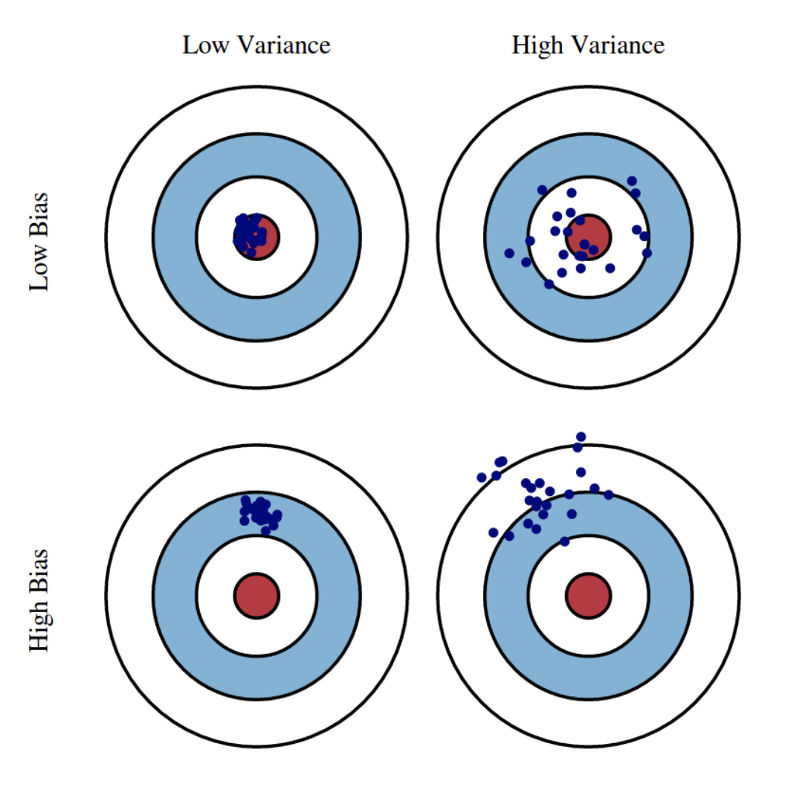{fig-align="center" width="60%"}

## Recap: Bias of an Estimator

- Suppose that we have an estimator of a parameter, say $\hat\theta$ for a parameter $\theta$ in a data generating model. Then the $\mathrm{bias}(\hat\theta)$ is defined by

  $$\mathrm{bias}(\hat\theta)=E[\hat\theta]-\theta$$

:::{.fragment}
- For example, suppose that you have a data generating model $y_i=\mathbf{x}_i^T\boldsymbol\beta+\epsilon_i$ with $\epsilon_i\overset{i.i.d.}{\sim}N(0,\sigma^2)$. Then the bias of the fitted value $X\hat\beta_{LS}$ is zero because

  $$E[X\hat\beta_{LS}]=E\left(X(X^TX)^{-1}X^Ty\right)=X\beta$$
::: 

<br> 

:::{.fragment}
- A few examples covered in this course
  - (ordinary/weighted/generalized/etc) least squares (unbiased)
  - MLE solution (asymptotically unbiased)
  
::: 

## Bias-Variance Tradeoff

- Suppose that the true DGP is $y_i=f(x_i)+\epsilon_i$, where $f(x_i)$ and $\epsilon_i$ are independent and $\epsilon_i$ has mean 0 and variance $\sigma^2$.
  - Note that we don’t enforce $f(x)=x^T\beta$.
  
  <br> 
  <br> 
  
- If we consider ‘any’ method $\hat f$ that obtains $f$, then the mean square error (MSE), that can be used to quantify how closely $\hat f(x)$ approximates $y$.

  $$\mathrm{MSE}(\hat f)=E\left[(y-\hat f(x))^2\right]$$

## Bias-Variance Tradeoff

- In practice, the true DGP is [unknown]{.maroon} and we cannot compute the MSE directly.

<br> 
<br> 

- A more natural option is the ‘empirical’ MSE, which is computed by

  $$\widehat{\mathrm{MSE}}(\hat f)=\frac{1}{n}\sum_{i=1}^n(y_i-\hat f(x_i))^2$$

  - It can always be obtained without knowing the true DGP.

## Bias-Variance Tradeoff

- Bias-variance tradeoff:

  $$\mathrm{MSE}(\hat f(x))=\sigma^2+\mathrm{Bias}^2(\hat f(x))+\mathrm{Var}(\hat f(x))$$

  where
  - $\sigma^2$ is an **irreducible noise**
  - **Bias**: $E[\hat f(x)]-f(x)$
  - **Variance**: $E[(E(\hat f(x))-\hat f(x))^2]$ $\qquad \mathrm{Var}(X)=E[(X-E(X))^2]$

## Bias-Variance Tradeoff

- For notational simplicity, let $\hat f\equiv\hat f(x)$. Then

$$\begin{aligned}
\mathrm{MSE}(\hat f)&=E[(y-\hat f)^2]=E[(f+\epsilon-\hat f)^2]\\
&=E[(f-E(\hat f)+\epsilon+E(\hat f)-\hat f)^2]\\
&=E[(f-E(\hat f))^2]+E[\epsilon^2]+E[(E(\hat f)-\hat f)^2]\\
&\quad+2(f-E(\hat f))E[\epsilon]+2E[\epsilon]E[E(\hat f)-\hat f]\\
&\quad+2E[E(\hat f)-\hat f](f-E(\hat f))\\
&=(f-E(\hat f))^2+E[\epsilon^2]+E[(E(\hat f)-\hat f)^2]\\
&=\mathrm{Bias}^2(\hat f)+\sigma^2+\mathrm{Var}(\hat f)
\end{aligned}$$

## Bias-Variance Tradeoff

- **Bias-variance tradeoff provides an explicit understanding of how ‘models’ work.**

  - We may build a prediction model, possibly biased, which reduces MSE by significantly reducing the variance.

<br><br>

:::{.fragment}
- It is very useful in understanding
  - Complex versus simple models
  - Parametric versus nonparametric models
  - Linear versus nonlinear models
  - Frequentist versus Bayesian models
  - etc.
  
::: 

## MSE and Overfitting

:::: {.columns}
::: {.column width="40%"}

- MSE needs to be computed from the dataset [independent]{.maroon} of the one used to obtain (i.e., train) the model $\hat f$.

<br><br> 

- Otherwise, MSE could easily go to 0 just as the model complexity increases

  - e.g., more covariates are added.

:::
::: {.column width="60%"}
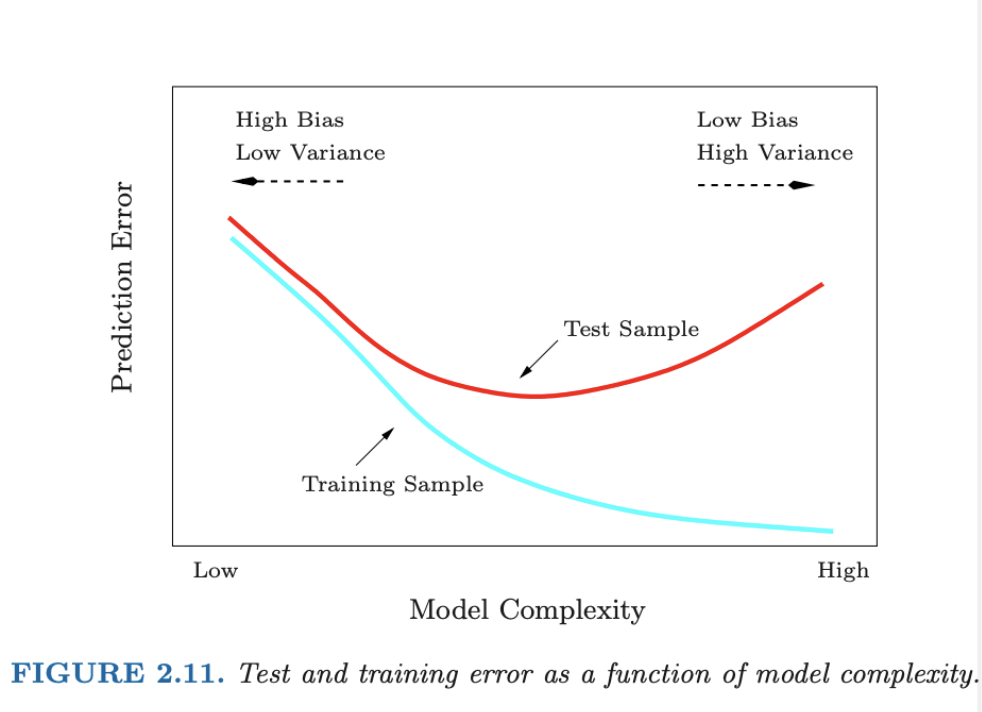{fig-align="center" width="100%"}
:::
::::


# Penalized Regression

## Penalized Regression

- Why do we even want to avoid using ordinary least squares?

  - **Model interpretability**: not all of the predictors would be associated with the outcome. Including such irrelevant variables leads to unnecessary complexity in the resulting model.
  
  - **Prediction accuracy**: OLS would be fine when $n\gg p$. However, it would easily overfit when $n$ is not much larger than $p$. It does not even have a unique solution when $p>n$.

## Penalized Regression

- The key idea of [**penalized regression**]{.maroon} is to impose a restriction on $\beta$.

<br> 

- Penalized regression finds the $\beta$ that minimizes the following objective function:

  $$\sum_{i=1}^n(y_i-\mathbf{x}_i^T\boldsymbol\beta)^2+P_\lambda(\boldsymbol\beta)$$

  where $P_\lambda(\beta)$ is the [penalty function]{.maroon} that depending on $\lambda$.

<br> 

:::{.fragment}
- For non-continuous data, the ‘SSE’ part above could be replaced by (or ‘generalized to’) the negative log likelihood. For binary data,

  $$\underbrace{-\sum_{i=1}^n\{y_i\log(p_i)+(1-y_i)\log(1-p_i)\}}_{\text{negative log likelihood}}+\underbrace{P_\lambda(\beta)}_{\text{penalty}}$$
::: 

## Penalized Regression

[**AIC and BIC as Penalized Regression**]{.maroon}

$$\mathrm{AIC}(\beta)=-2\log L(\beta)+2\times\|\beta\|_0$$
$$\mathrm{BIC}(\beta)=-2\log L(\beta)+\log(n)\times\|\beta\|_0$$

- Finding $\hat\beta$ that minimizes $\mathrm{AIC}(\beta)$ (or $\mathrm{BIC}(\beta)$) is one way to prevent overfitting by imposing a $L_0$ penalty on $\beta$ with $\lambda=2$ (AIC) or $\lambda=\log(n)$ (BIC) where

  $$\|\beta\|_0=\sum_{j=1}^p I(\beta_j\ne 0)$$

:::{.fragment} 
- In practice, there is no closed-form solution for AIC and BIC, and AIC and BIC would be infeasible when $p$ is large.
  - e.g., $2^{20}\approx 1$ million models to compare

::: 

## Possible Penalities

- Instead, we consider the following penalties, with $\lambda>0$:
  - $\lambda\cdot\sum_{j=1}^p\beta_j^2$: This is called the ‘ridge’ penalty.
  - $\lambda\cdot\sum_{j=1}^p|\beta_j|$: This is called the ‘LASSO’ penalty.
  - A combination of ridge and LASSO penalties: $\lambda_1\cdot\sum_{j=1}^p|\beta_j|+\lambda_2/2\cdot\sum_{j=1}^p\beta_j^2$: This is called the ‘elastic net’ penalty.
  
:::{.fragment}
- When $\lambda=0$, there is no penalty imposed and it becomes least squares.

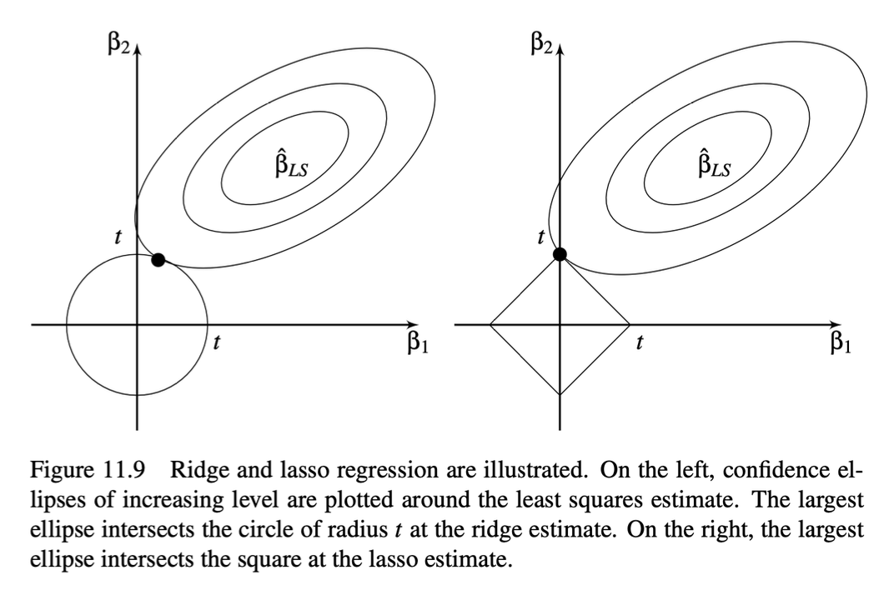{fig-align="center" width="60%"}
::: 

## Possible Penalities

[**1. Ridge Regression**]{.maroon}

- With $\lambda>0$, the ridge regression minimizes the following objective function:

  $$\|y-X\beta\|_2^2+\lambda\|\beta\|_2^2\quad\text{or, equivalently,}\quad\sum_{i=1}^n(y_i-x_i^T\beta)^2+\lambda\sum_{j=1}^p\beta_j^2$$

  - It penalizes $\beta$ from being $\hat\beta_{LS}$ by imposing a restriction on $\sum_{j=1}^p\beta_j^2<t$ for some $t$ (Lagrangian).

## Possible Penalities

[**1. Ridge Regression**]{.maroon}

- With fixed $\lambda$, it can be shown that

$$
\hat\beta_{\mathrm{ridge},\lambda}
={\color{blue}{(X^TX+\lambda I)}^{-1}}X^Ty
$$

  Note that the blue part is always invertible, even when $p>n$! There always exists a unique solution.

<br> 

:::{.fragment}
- $\hat\beta_{\mathrm{ridge},\lambda}$ is a biased estimator for $\beta$:

  $$\mathrm{bias}(\hat\beta_{\mathrm{ridge},\lambda})=E[\hat\beta_{\mathrm{ridge},\lambda}]-\beta=[(X^TX+\lambda I)^{-1}X^TX-I]\beta\ne0$$

  unless $\beta=0$.
::: 

## Possible Penalities

[**1. Ridge Regression: Tuning Parameter**]{.maroon}

:::: {.columns}
::: {.column width="60%"}
- Choice of $\lambda>0$ is important to balance the [tradeoff between bias and variance]{.maroon}. The $\lambda$ value decides a degree of bias you’re infusing to make MSE the lowest.

<br> 

  - When $\lambda=0$, then there is *no bias* (OLS) but may have *high variance*.
  - When $\lambda\to\infty$, then $(X^TX+\lambda I)^{-1}\approx(1/\lambda)I\to0$, making most elements of $\hat\beta_\lambda$ similar to 0. (*low variance* but *high bias*).

:::
::: {.column width="40%"}
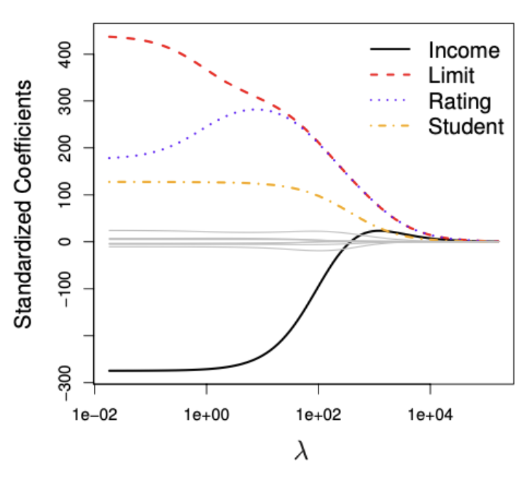{fig-align="center" width="100%"}
:::
::::


## Possible Penalities

[**1. Ridge Regression**]{.maroon}

- **Advantages**:
  - Ridge [reduces the variance]{.maroon} of fitted model by trading off the bias
  - Computationally efficient
  - Relaxing multicolinearilty: in some cases, $X^TX$ almost singular (e.g., $p>n$, or some variables are highly correlated), then $(X^TX+\lambda I)^{-1}$ removes singularity.
  
  <br> 
  
- **Disadvantages**:
  - it tends to include all $p$ covariates in the fitted model $\Rightarrow$ not appropriate for variable selection.

## Possible Penalities

[**1. Standardization in Ridge Regression**]{.maroon}

- The ridge penalty (and others in Lecture 7) is [scale-dependent]{.maroon}: larger-scaled covariates or response values are penalized less.

- **Standardization**
  - Each covariate ($x_j$) and response ($y$) are scaled to zero mean and unit variance:

    $$x_{ij}^{std}=\frac{x_{ij}-\bar x_j}{s_j}\quad\text{and}\quad y^{std}=\frac{y-\bar y}{s_y}.$$

<br> 

- **Benefits**
  - Ensures all variables are on the same scale, making the penalty fair across coefficients.
  - Simplifies interpretation of penalization, as coefficients are directly comparable.
  - After standardization, the intercept term disappears.

## Possible Penalities

[**1. Standardization in Ridge Regression**]{.maroon}

- **Estimated Coefficients from Standardized Data**:

  $\hat\beta_j^{std}$ = estimated coefficients on standardized covariates and response.

<br> 

- Rescaling to the original scale:

  $$\hat\beta_j=\frac{\hat\beta_j^{std}\cdot s_y}{s_j},\quad\text{and}\quad\hat\beta_0=\bar y-\sum_j\hat\beta_j\bar x_j,$$

  where:
  - $\hat\beta_j$: coefficient on the original scale.
  - $\hat\beta_0$: intercept on the original scale.

## Possible Penalities

[**2. LASSO**]{.maroon}

:::: {.columns}
::: {.column width="60%"}
- When $\lambda>0$ is given, find the $\beta$ that minimizes the following objective function:

  $$\sum_{i=1}^n(y_i-x_i^T\beta)^2+\lambda\sum_{j=1}^p|\beta_j|$$

  - Similar to ridge, it penalizes $\beta_j$s from fully growing by imposing a restriction on $\sum_{j=1}^p|\beta_j|<t$ for some $t$ (Lagrangian).
  - Due to theoretical properties of the penalty, it will provide a sparse estimate of $\hat\beta_\lambda$s, i.e. [it achieves both regularization and variable selection at once]{.maroon}.
  - Similar to ridge regression, parameter estimates are [biased]{.maroon} in general.

:::
::: {.column width="40%"}
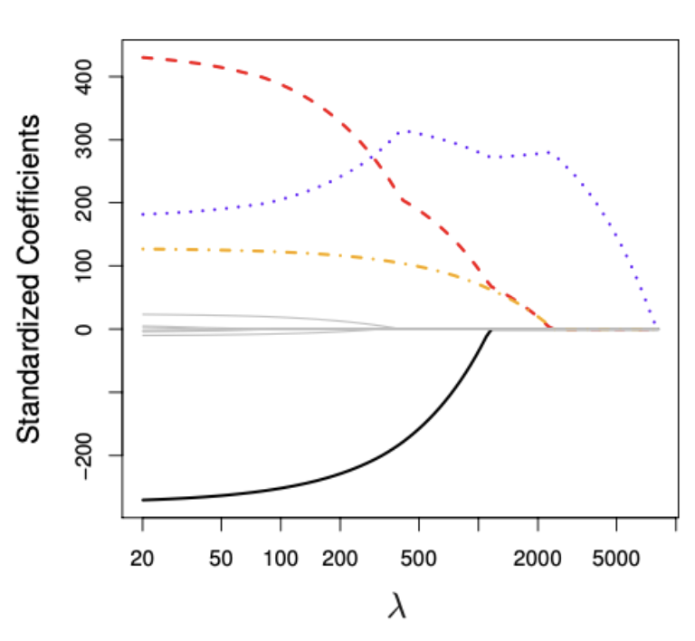{fig-align="center" width="100%"}
:::
::::

## Possible Penalities

[**2. LASSO: Finding the Solution**]{.maroon}

- When there is one covariate $x_i$ and a response $y_i$ where both are standardized, we consider the following optimization problem:

  $$\frac12\sum_{i=1}^n(y_i^{std}-\beta x_i^{std})^2+\lambda|\beta|$$

- The solution for the optimization problem above is given by

  $$\hat\beta_{\mathrm{LASSO},\lambda}=\mathrm{sign}(\hat\rho_{x,y})\cdot\max\left(0,|\hat\rho_{x,y}|-\frac\lambda n\right)$$

  where $\hat\rho_{x,y}$ is the correlation between $x$ and $y$.

## Possible Penalities

[**2. LASSO: Finding the Solution**]{.maroon}

- Coordinate descent: update each parameter until reaching the convergence.

  1. Initialization: Set $\hat\beta=0$.
  
  2. Coordinate-wise update: For each $j=1,\ldots,p$, update $\hat\beta_j$ by fixing all the other parameters estimates as fixed ($\hat\beta_1,\ldots,\hat\beta_{j-1},\beta_{j+1},\ldots,\beta_p$) with the current estimates:

     $$\begin{aligned}\hat\beta_j&=\arg\min_{\beta_j}\left\{\sum_{i=1}^n(y_i-\sum_{j=1}^px_{ij}\beta_j)^2+\lambda\sum_{j=1}^p|\beta_j|\right\}\\
     &=\arg\min_{\beta_j}\left\{\sum_{i=1}^n(y_i-\sum_{k\ne j}x_{ik}\beta_k-x_{ij}\beta_j)^2+\lambda|\beta_j|\right\}\end{aligned}$$

  3. Repeat Step 2 until convergence: Iterate over all $j$ until the coefficients stabilize.

## Possible Penalities

[**2. LASSO**]{.maroon}

- **Disadvantages of LASSO**:

  - Lasso tends to select at most $n$ variables, where $n$ is the sample size. (problematic when the true model involves more variables)
  - Lasso arbitrarily selects one variable from a group of highly correlated predictors, ignoring others (which might not be desirable in some contexts).

## Possible Penalities

[**Comparing Ridge and LASSO Regressions**]{.maroon}

- Neither ridge regression nor the LASSO will universally dominate the other.

<br><br> 

- In general, one might expect

  - **LASSO to perform better**: a relatively small number of predictors have substantial coefficients, and the remaining predictors have coefficients that are very small or that equal zero.
  
  - **Ridge regression to perform better**: the response is a function of many predictors, all with coefficients of roughly equal size. *(Note: The number of predictors that is related to the response is never known a priori for real data sets.)*


## Possible Penalties

[**3. Elastic Net**]{.maroon}

- Objective Function:

  $$
  \min_\beta \frac{1}{2n}\|y-X\beta\|_2^2
  +\lambda\left[\alpha\|\beta\|_1
  +\frac{1-\alpha}{2}\|\beta\|_2^2\right]
  $$

  where:
  - $\|\beta\|_1=\sum_j|\beta_j|$: LASSO penalty.
  - $\|\beta\|_2^2=\sum_j\beta_j^2$: Ridge penalty.
  - $\alpha\in[0,1]$: controls the balance between LASSO and Ridge.
  - $\lambda\geq 0$: controls the overall strength of regularization.

<br>

:::{.fragment}
- [Elastic Net blends (i) the sparsity of LASSO and (ii) the grouping effect of Ridge]{.maroon}.

- **Disadvantage**: Requires tuning two parameters, $\alpha$ and $\lambda$, typically using cross-validation.

::: 

## Implementations with glmnet in R

- Basic: `glmnet(X, y, family, alpha, lambda)`

  - X: the X matrix (not including the intercept)
  - y: the y vector
  - alpha: 1 (LASSO), 0 (Ridge), the value between 0 and 1 (elastic net)
  - lambda: the $\lambda$ value after standardizing the variables

## Inference with Penalized Regression

- In this chapter we have focused mostly on estimation, not inference.

<br> 

- In practice, biased coefficient estimates provided by penalized regression make statistical inference challenging.

  - Also, uncertainty quantification (i.e., variance) is challenging
  
<br> 

- Despite decent theoretical developments made in statistics (e.g., debiased LASSO, selective inference, etc), they are not fully practical yet.

# Extensions


## More General Formulations

- Negative log likelihood, when it is well-specified in terms of the data generating model, provides a good loss function, and the penalties ($\sum_{j=1}^p|\beta_j|$ or $\sum_{j=1}^p\beta_j^2$) provides a good ‘prior’ (in Bayesian contexts). However, are these the only possible choices that we can use?

<br> 

:::{.fragment}
- Actually, if our purpose is not constructing the data generating model but building a good classification model that prevents overfitting, using the (negative) likelihood as a loss function might not be necessary. 

<br> 

- Many ‘machine learning’ models can be formulated by

  $$[\text{A loss function}]+[\text{A penalty function}]$$

::: 

## More General Formulations

[**1. Modifying the Loss Function**]{.maroon}

- Suppose that $y_i\in\{-1,1\}$. The soft-margin support vector machine (SVM) classifier can be obtained by minimizing

  $$\underbrace{\sum_{i=1}^n\max(0,1-y_i\cdot x_i^T\beta)}_{\text{aka ‘hinge loss’}}+\underbrace{\lambda\sum_{j=1}^p\beta_j^2}_{\text{Ridge penalty}}$$

  - This framework gives an understanding of why SVM is robust to high-dimensional data: [there is a ridge penalty that prevents overfitting]{.maroon}.
  - If the ridge penalty is replaced by $\lambda\sum_{j=1}^p|\beta_j|$, it will give you sparse estimates of $\beta$.
  - A more general hinge-loss function is constructed by replacing $x_i^T\beta$ with $f(x_i)$.
  - **Cautionary note**: I didn’t say it is easy to optimize.

## More General Formulations

[**1. Modifying the Loss Function**]{.maroon}

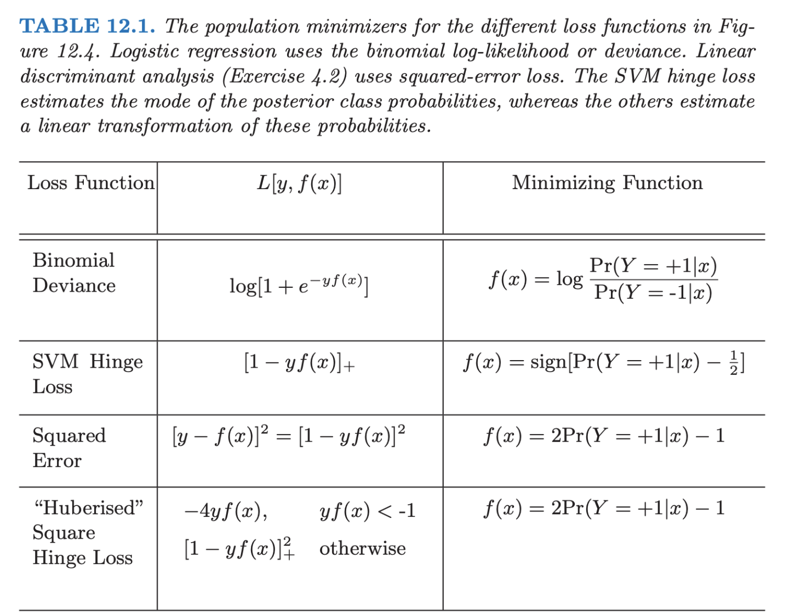{fig-align="center" width="60%"}

## More General Formulations

[**1. Modifying the Loss Function**]{.maroon}

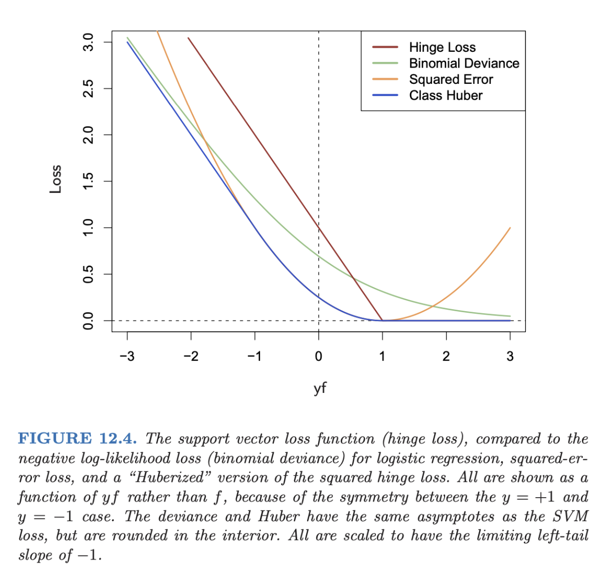{fig-align="center" width="60%"}

## More General Formulations

[**2. Modifying the Penalty Function**]{.maroon}

- We can also consider different penalties based on different vector norms:
  - LASSO penalty: $P_\lambda(\beta)=\lambda\cdot|\beta|$
  - Ridge penalty: $P_\lambda(\beta)=\lambda\cdot\beta^2$
  - $L_q$ penalty: $P_\lambda(\beta)=\lambda\cdot|\beta|^q$
  - $L_0$ penalty: $P_\lambda(\beta)=\lambda\cdot I(\beta\ne0)$.

- When $0\le q\le1$, the resulting coefficient estimates would be sparse.
- When $0\le q<1$, it is not guaranteed to converge to a global minimum.

::::[.fragment]
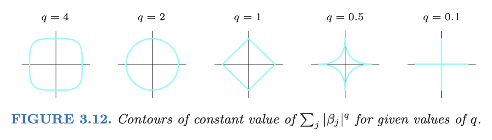{fig-align="center" width="60%"}
::: 

## More General Formulations

[**2. Modifying the Penalty Function**]{.maroon}

:::: {.columns}
::: {.column width="60%"}
- Minimax concave penalty (MCP):

  $$P_{\lambda,\gamma}(\beta)=\begin{cases}\lambda|\beta|-\beta^2/(2\gamma)&\text{if }|\beta|\le\lambda\gamma\\\frac12\gamma\lambda^2&\text{if }|\beta|>\lambda\gamma\end{cases}$$

- Smoothly clipped absolute deviations (SCAD) penalty:

  $$P_{\lambda,\gamma}(\beta)=\begin{cases}\lambda|\beta|&\text{if }|\beta|\le\lambda\\\frac{2\gamma\lambda|\beta|-\beta^2-\lambda^2}{2(\gamma-1)}&\text{if }\lambda<|\beta|<\lambda\gamma\\\frac{\lambda^2(\gamma+1)}2&\text{if }|\beta|>\lambda\gamma\end{cases}$$

- Truncated LASSO Penalty (TLP)

  $$P_{\lambda,\tau}(\beta)=\lambda\cdot\min(|\beta|/\tau,1)$$

Implementation for MCP and SCAD: ncvreg, TLP: glmtlp 

:::
::: {.column width="40%"}
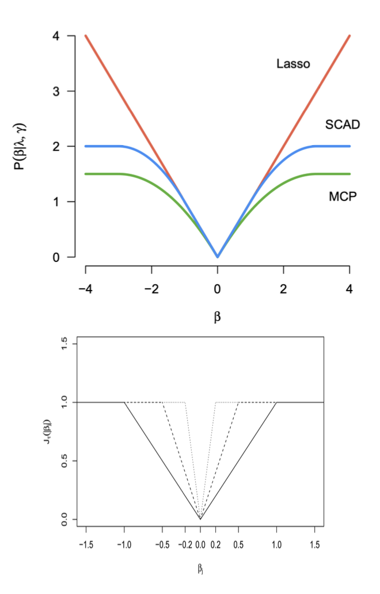{fig-align="center" width="70%"}
:::
::::

## More General Formulations

[**2. Modifying the Penalty Function**]{.maroon}

- Similar to the $L_q$ penalty with $0<q<1$, it is not guaranteed that optimization with SCAD, MCP, or TLP will converge to a global minimum

<br> 

- Then why use these ‘non-standard’ forms of penalty?

  1. Reduced bias (for large coefficients): LASSO/ridge/elastic net introduces severe bias for large coefficients because the penalty grows with the absolute value of coefficients.
  2. Sparsity: SCAD, MCP, TLP still provide sparse coefficient estimates.
  3. Oracle property: they can correctly identify the true set of non-zero coefficients.

## Example: Fused LASSO

- **Motivating question**: in this time series data, can we identify the jumping points where means change?

- We assume

  $$y_i\sim N(\mu_j,\sigma^2)$$

  where $\mu_j$ are distinct means

- We want $\mu_j$ to be mostly constant over time except for the jumping points.

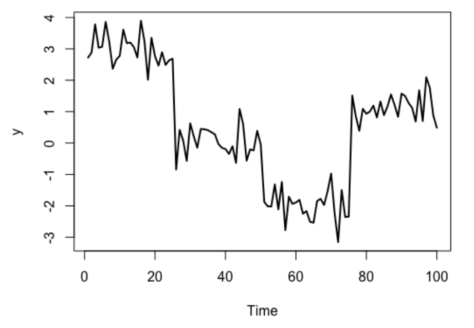{fig-align="center" width="70%"}

## Example: Fused LASSO

- The LASSO penalty can be modified to induce smoothing.

  $$\min_{\beta\in\mathbb R^n}\left\{\sum_{i=1}^N(y_i-\beta_0-\beta_i)^2+\lambda\sum_{i=1}^{n-1}|\beta_{i+1}-\beta_i|\right\}.$$

- The ‘loss function’ assumes that each $y_i$ has different means, but
- The penalty function penalizes the ‘difference between the means’ between two time points $(i,i+1)$
- Because of the LASSO penalty, many $(\beta_{i+1}-\beta_i)$ terms will shrink to 0.

## Example: Fused LASSO

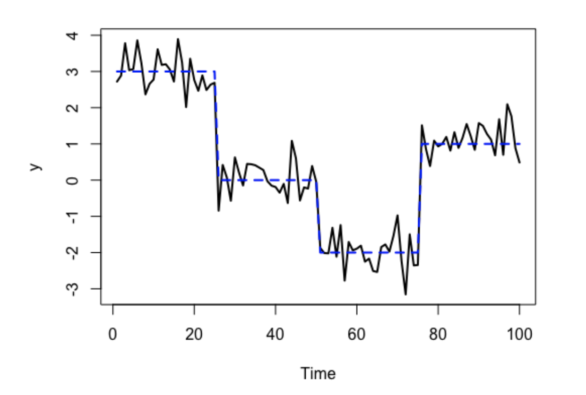{fig-align="center" width="80%"}

# Choosing tuning parameters

## Model Selection

- Finding the best tuning parameter (e.g., $\lambda$) is critical in prediction.

<br> 

- Ideally, when no other information is given, we may want to minimize the mean square error (MSE). 

<br> 

- One approach is to view the regression with different $\lambda$s as different ‘models’ and choose the best model by keeping the rule of ‘not using data twice’. 

<br> 

- It naturally leads to the idea of cross validation.

## Model Selection

[**1. Cross Validation**]{.maroon}

- Cross validation is a technique to partition the original data into several non-overlapping sub-data sets and evaluate the model’s predictive performances.

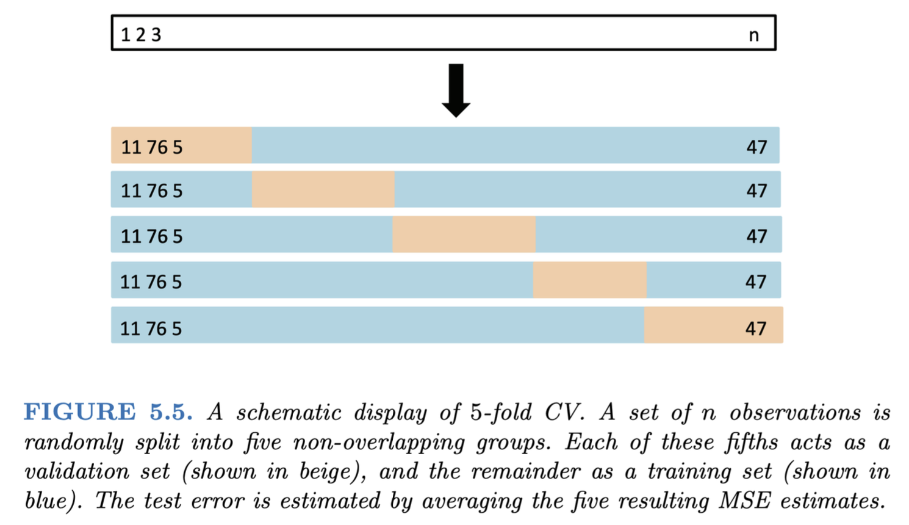{fig-align="center" width="70%"}

## Model Selection

[**1. Cross Validation**]{.maroon}

- Procedures (5 fold CV) in comparing different models

  1. Choose 4 folds out of 5, fit each model $\Rightarrow f_{train}(\cdot)$.
  
  2. Apply it to the fold $\{y_{test},X_{test}\}$ not used in 1 and compute the predicted MSE:

     $$\mathrm{MSE}_{test}=\|y_{test}-f_{train}(X)\|_2^2$$

  3. Repeat 1 and 2 5 times using different folds of data, and take the average MSE across 5 folds for each model.
  
  4. Choose the model with the lowest average MSE.

## Model Selection

[**1. Cross Validation**]{.maroon}

- For LASSO/Ridge/Elastic net, glmnet has an option `cv.glmnet()` function that implment CV-based choice of $\lambda$.

- The red dots denote for average prediction error for each ($\lambda$) value using cross validation. It neither chose $\lambda=0$ or $\lambda=\infty$ but chose $\log(\lambda)\approx-2.1$ that is the ‘best’ in making a balance between bias and variance.

```r
library(glmnet)
fit = cv.glmnet(X, y, alpha = 1,
                 nfolds=10)
plot(fit)
```

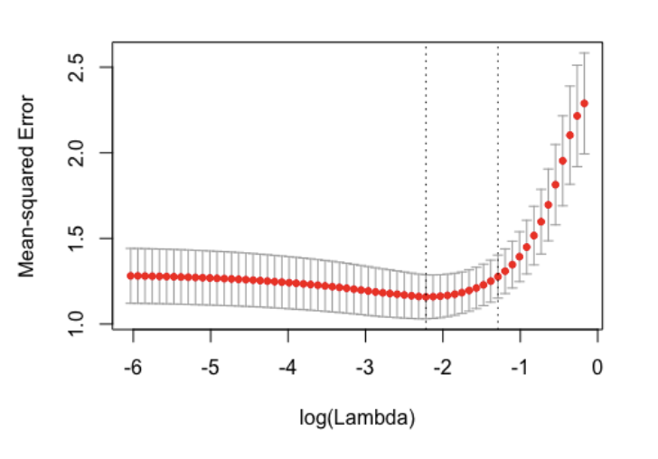{fig-align="center" width="70%"}

## Model Selection

[**1. Cross Validation**]{.maroon}

- Cross validation is useful because it can be applied to compare performances of different (including non-likelihood-based) methods.
- Partitioning samples into several folds includes some degrees of randomness, but one can use leave-one-out cross validation (LOOCV) that has $n$ folds for $n$ samples.
- LOOCV could be computationally demanding especially when $n$ is large.

## Model Selection

[**2. Generalized Cross Validation**]{.maroon}

- If we restrict our attention to a linear smoother fit where a fitted model could be represented by $\hat y=S_\lambda y$ for some $S_\lambda$, then generalized cross validation (GCV) approximates the LOOCV.

  $$\mathrm{GCV}(\lambda)=\frac{\|y-\hat y\|^2/n}{(1-\mathrm{tr}(S_\lambda)/n)^2},$$

- Ridge regression is an example of linear smoother, but LASSO and other methods aren’t.
- Despite its name, GCV does not partition data into several folds. It requires fitting model once for each $\lambda$. (computationally efficient)
- The $1-\mathrm{tr}(S_\lambda)/n$ in the denominator is called the ‘effective degrees of freedom’ that summarizes the model complexity for a specific $\lambda$ value.

## Model Selection

[**3. Likelihood Based Approaches**]{.maroon}

- Alternative viewpoint for Ridge regression:

  $$y=X\beta+\epsilon\quad\text{where}\quad\beta\sim MVN(0,\tau^2I)\quad\text{and}\quad\epsilon\sim MVN(0,\sigma^2I)$$

  under this setup,
  - Finding BLUP of $\beta$ $\Rightarrow$ ridge regression
  - $\lambda=\sigma^2/\tau^2$.
  - $\sigma^2$ and $\tau^2$ could be directly ‘estimated’ by maximizing a likelihood

- Alternatively, you may think of $\tau^2$ given in the form of prior in Bayesian linear regression.
  - Finding the Bayes estimator $\hat\beta_{Bayes}$ is equivalent to ridge regression.
  - $\lambda=\sigma^2/\tau^2$ is determined by your prior knowledge of $\tau^2$
  
  
## Summary

- **Bias-variance tradeoff:** Introducing some bias can reduce variance and improve prediction accuracy.

- **Penalized regression:** We minimize a loss function plus a penalty to control model complexity and prevent overfitting.

- **Common penalties:**
  - **Ridge ($L_2$):** Shrinks coefficients toward zero but does not perform variable selection.
  - **LASSO ($L_1$):** Shrinks coefficients and can set some exactly to zero.
  - **Elastic Net:** Combines ridge and LASSO, particularly useful with correlated predictors.

- **Extensions:** Different loss functions and penalties allow us to address different modelling goals.

- **Choosing tuning parameters:**
  - **Cross-validation:** Evaluates predictive performance on held-out data.
  - **Generalized cross-validation:** Efficiently approximates LOOCV for linear smoothers.
  - **Likelihood-based approaches:** Can estimate tuning parameters through probabilistic assumptions.

Announcements: Assignment available on course website, due Dec. 4th

