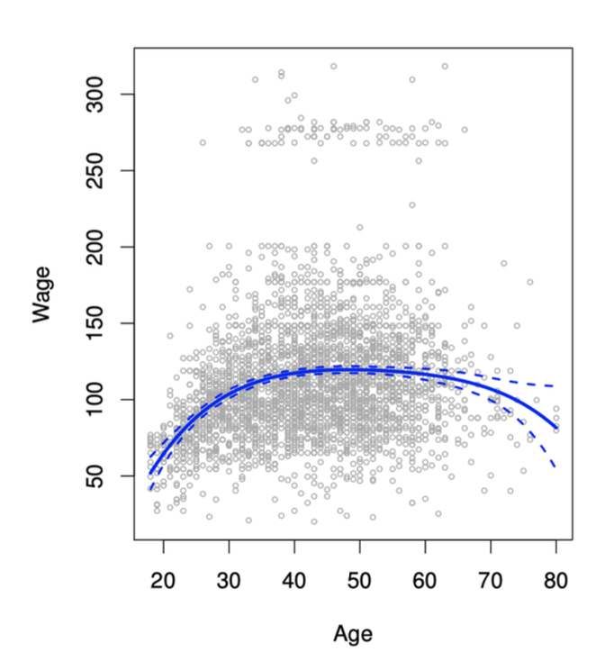
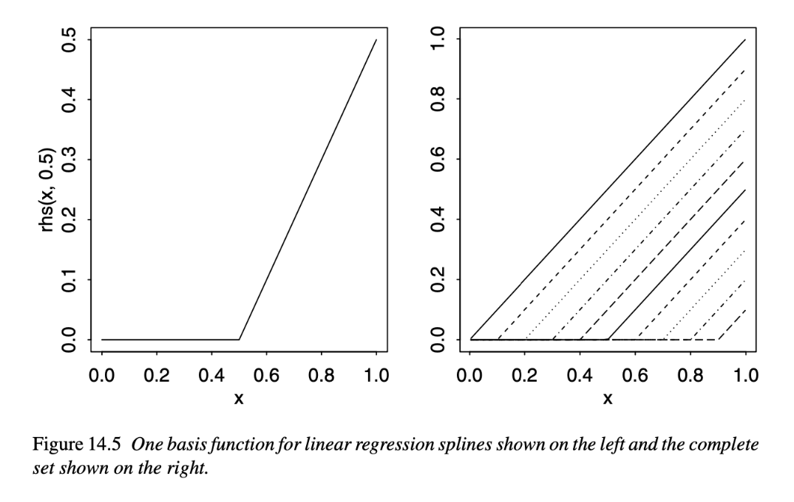
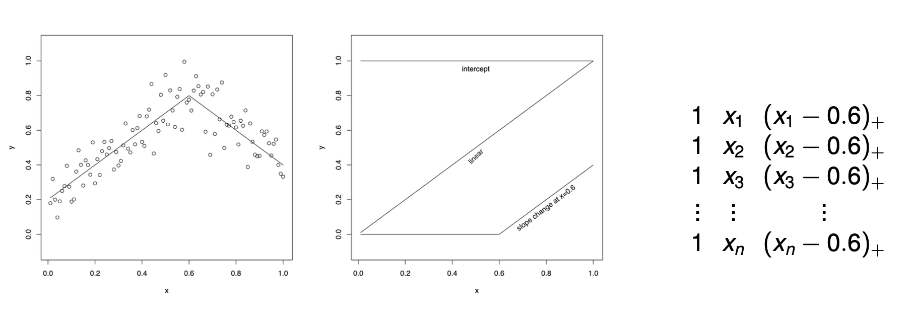
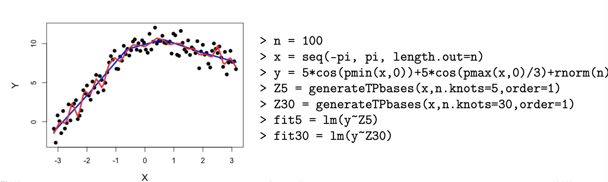
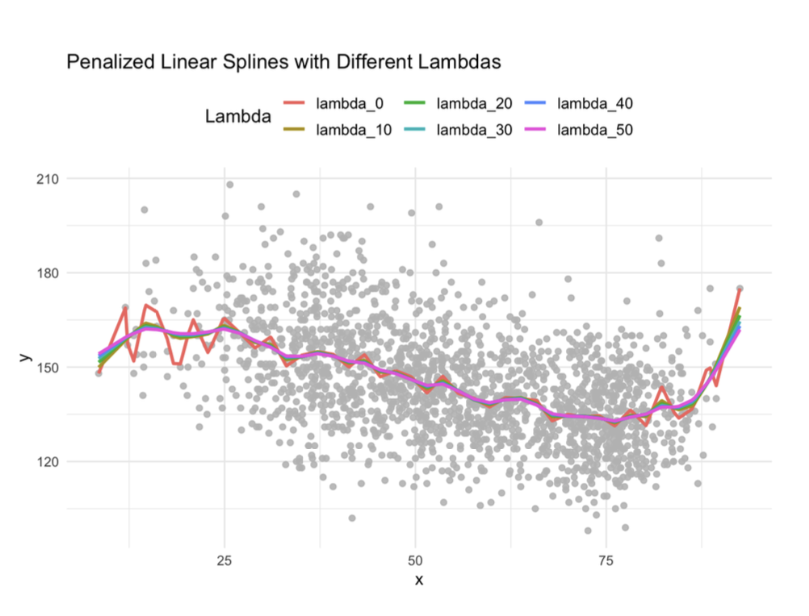
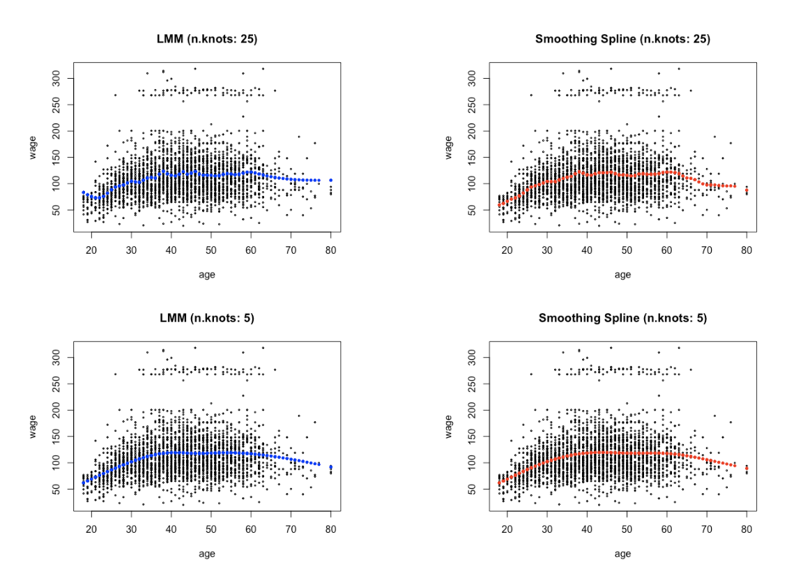
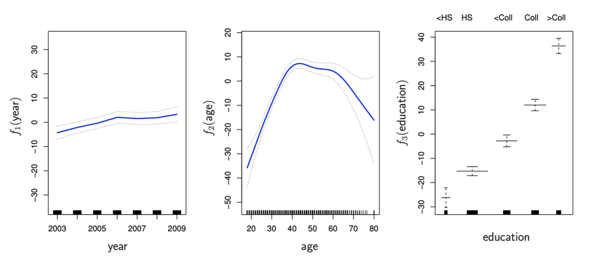

# Case Study: Penalized Regression 

## Case Study

A hospital is interested in predicting patients' systolic blood pressure using demographic information, lifestyle factors, and medical measurements.

The dataset contains 200 patients and 100 predictors. Some predictors are highly correlated (e.g., BMI, weight, and waist circumference).

The researchers are considering four approaches:

1. Ordinary least squares (OLS)
2. Ridge regression
3. LASSO
4. Elastic net

**Questions:**

1. What potential problems might arise if we use OLS?
2. Which of the four methods would you recommend, and why?
3. How would your recommendation change if you knew that only five predictors were truly associated with blood pressure?

## Case Study

The researchers decide to fit LASSO regression and use 10-fold cross-validation to choose $\lambda$.

They obtain the following results:

| $\lambda$ | CV MSE |
|-----------:|-------:|
| 0.001 | 120 |
| 0.01  | 105 |
| 0.1   | 92  |
| 1     | 98  |
| 10    | 145 |

**Questions:**

1. Which value of $\lambda$ would you choose? Explain.
2. Why does the prediction error increase when $\lambda$ becomes very large?
3. Suppose the researchers choose $\lambda=0.001$ because it produces the smallest training MSE. What is wrong with their reasoning?

## Case Study

After selecting their tuning parameters, the researchers obtain the following results on an independent test set:

| Model | Test MSE | Nonzero coefficients |
|:------|---------:|---------------------:|
| OLS | 130 | 100 |
| Ridge | 91 | 100 |
| LASSO | 95 | 12 |
| Elastic net | 89 | 35 |

**Questions:**

1. Which model would you recommend if the primary goal is prediction? What if interpretability is important?
2. Why might elastic net outperform LASSO in this example?
3. A researcher claims that the 12 predictors selected by LASSO are the only variables that truly affect blood pressure. Do you agree?

## Table of Contents

- Penalized splines
- Generalized additive model (GAM)

# Penalized splines 

## Moving Beyond Linearity

- Almost everything in this course covers 'linear' associations between two random variables. If we had $x$ and $y$, then we modeled their linear relationship by

  $$y_i = \beta_0 + x_i\beta_1 + \epsilon_i$$

<br> 

- When the true relationship between $y$ and $x$ is [non-linear]{.maroon} (e.g. quadratic), then using linear regression is a [not]{.maroon} a good idea. 

<br> 

- Today's class covers how we can construct better models given complex data.

## Polynomial Regression

- The simplest method to account for the potential linearity is to [add higher-order terms]{.maroon} of $x$. For example,

  $$y_i=f(x_i)+\epsilon_i=\beta_0+x_i\beta_1+x_i^2\beta_2+x_i^3\beta_3+\epsilon_i$$

<br> 

- Here we're not really interested in each regression coefficients. Rather, we are more interested in the fitted values $f(x_i)$. You may also draw a confidence interval for each fitted value. 

<br> 

- We may add more higher-order terms to the model, but it does not mean that it is always beneficial.

  - There is always an issue of overfitting.
  - Appropriate higher order terms must be chosen before you fit a model.

## Polynomial Regression

{fig-align="center" width="70%"}

- Prediction of wage with age using 4th-order polynomial regression, with 95% CI.

## Splines

[**Smooth polynomial lines**]{.maroon}

- Instead of using higher order polynomials, we fix the order but try different ['bases']{.maroon} based on the ['knots']{.maroon} that we placed. 

<br> 

- We mildly assume that these bases are 'relatively sufficient' to approximate (possibly non-linear) function $f(x)$. 

<br> 

- There are different bases one can try, as you'll see later. The goal is not to have the fitted values that are exactly the same across all bases functions (it is never possible). Rather, we care more about 'approximations'.

## Simple Splines

[**Let the slope change many times**]{.maroon}

$$y_i = \beta_0+x_i\beta_1+\sum_{j=1}^K (x_i-\kappa_j)_+\gamma_j+\epsilon_i$$

where $(x_i-\kappa_j)_+=x_i-\kappa_j$ if it is greater than 0 and 0 otherwise.

- It is (for now) just the same as constructing many variables derived from $x$ ($(x_i-\kappa_j)_+$) and fitting a multiple linear regression.

:::{.fragment}
- $\kappa_1,\ldots,\kappa_K$ are called [**'knots'**]{.maroon}.

  - They must be chosen before you conduct any analysis.
  - Ideally, it must be placed at points where slope changes are expected.
  - In practice, these locations are unknown and it is chosen to have equal distances (i.e., equally spaced).
  
::: 

## Truncated Linear Basis

{fig-align="center" width="70%"}

```r
x = seq(0, 1, length.out=1000)
Z = generateTPbases(x, n.knots=15, order=1)
```

## Truncated Linear Basis

{fig-align="center" width="100%"}

## Truncated Linear Basis

- **Simulated example**: Let $y_i=f(x_i)+\epsilon_i$ where $\epsilon_i\sim N(0,1)$ and

  $$f(x_i)=5\cos(x_i)\quad\text{if }x_i<0\qquad\text{and}\qquad f(x_i)=5\cos(x_i/3)\quad\text{if }x_i>0$$

  - $K=5$ (blue) seems to be more appropriate here (although it is still not a 'correct' model) than $K=30$ (red; seems too wiggly).

{fig-align="center" width="70%"}

## Penalized Splines

- **Idea**: Use sufficiently many knots then penalize changes at the knots.
  - Instead of using multiple linear regression, we consider penalizing spline coefficients.

<br> 

:::{.fragment}
- In case of the truncated linear basis, we minimize

  $$\sum_{i=1}^{n}\left(y_i-\beta_0-x_i\beta_1-\sum_{j=1}^{K}(x_i-\kappa_j)_+\gamma_j\right)^2+\lambda\sum_{j=1}^{K}\gamma_j^2$$

  It relaxes the knot-selection issue, leaving a single $\lambda$ to be chosen. 

::: 

<br> 

:::{.fragment}
- Other penalty functions could be used, at the expense of computations in model fitting + choosing $\lambda$.

::: 

## Penalized Splines

- It can be reparametrized by $(\mathbf y-\mathbf X\boldsymbol\beta)^T(\mathbf y-\mathbf X\boldsymbol\beta)+\lambda\boldsymbol\beta^T\mathbf D\boldsymbol\beta$ where

$$
\mathbf y=\begin{bmatrix}y_1\\y_2\\\vdots\\y_n\end{bmatrix},\quad
\mathbf X=\begin{bmatrix}
1 & x_1 & (x_1-\kappa_1)_+ & \cdots & (x_1-\kappa_K)_+\\
1 & x_2 & (x_2-\kappa_1)_+ & \cdots & (x_2-\kappa_K)_+\\
\vdots & \vdots & \vdots & & \vdots\\
1 & x_n & (x_n-\kappa_1)_+ & \cdots & (x_n-\kappa_K)_+
\end{bmatrix},\quad
\mathbf D=\begin{bmatrix}0&0&\mathbf 0^T\\0&0&\mathbf 0^T\\\mathbf 0&\mathbf 0&\mathbf I_K\end{bmatrix}
$$

:::{.fragment}
- When $\lambda$ is provided, the closed form solution for $\boldsymbol\beta$ is

  $$\hat{\boldsymbol\beta}=(\mathbf X^T\mathbf X+\lambda\mathbf D)^{-1}\mathbf X^T\mathbf y$$

  - When $\lambda\to 0$, you obtain $\hat{\boldsymbol\beta}$ using OLS $\Rightarrow$ wiggly curve. (look familiar)?
  - When $\lambda\to\infty$, the spline terms are highly penalized and there are only the intercept and the linear slope term that survives.
  
::: 

## Penalized Splines

[**Example with different choices of $\lambda$s**]{.maroon}

{fig-align="center" width="70%"}

- $y$: daily non-accidental deaths in the 5-county New York City, 2001-2005.
- $x$: daily temperature in Fahrenheit

## Penalized Splines

[**Choosing $\lambda$**]{.maroon}

- The `gam()` function in the `mgcv` package uses generalized cross-validation (GCV), which is possible because $\hat{\mathbf y}=f(\mathbf X)=\mathbf S_\lambda\mathbf y$.

  1. Define $\mathbf S_\lambda=\mathbf X(\mathbf X^T\mathbf X+\lambda\mathbf D)^{-1}\mathbf X^T$.
  2. For each $\lambda$, compute

     $$\operatorname{GCV}(\lambda)=\frac{\sum_{i=1}^{n}[y_i-\hat f_\lambda(x_i)]^2}{[1-\operatorname{trace}(\mathbf S_\lambda)]^2}$$

  3. Choose $\lambda$ that yields the lowest $\operatorname{GCV}(\lambda)$.

## Penalized Splines as BLUPs

[**Choosing $\lambda$: Linear mixed effect formulation**]{.maroon}

- The penalized spline could be translated into a linear mixed model framework: $\mathbf y=\mathbf X\boldsymbol\beta+\mathbf Z\mathbf b+\boldsymbol\epsilon$ where

$$
\mathbf X=\begin{bmatrix}1&x_1\\1&x_2\\\vdots&\vdots\\1&x_n\end{bmatrix}
\quad\text{and}\quad
\mathbf Z=\begin{bmatrix}
(x_1-\kappa_1)_+&\cdots&(x_1-\kappa_K)_+\\
(x_2-\kappa_1)_+&\cdots&(x_2-\kappa_K)_+\\
\vdots&&\vdots\\
(x_n-\kappa_1)_+&\cdots&(x_n-\kappa_K)_+
\end{bmatrix}
$$

- Therefore, REML could be used to estimate parameters (i.e., $\sigma^2$, $\tau^2$) and predict random effects so that $\hat{\mathbf y}=\mathbf X\hat{\boldsymbol\beta}+\mathbf Z\hat{\mathbf b}$.
  - This approach is implemented in `REML=T` in the `gam()` function.
- Bayesian methods could be also used.

## Penalized Splines as BLUPs

{fig-align="center" width="70%"}

# Generalized additive models

## Generalized Additive Models

- A natural way to extend the multiple linear regression model is to replace linear predictors with splines.
  - Multiple linear regression:

    $$y_i=\beta_0+x_{i1}\beta_1+x_{i2}\beta_2+\cdots+x_{ip}\beta_p+\epsilon_i$$

  - Generalized additive models:

    $$y_i=\beta_0+f_1(x_{i1})+f_2(x_{i2})+\cdots+f_p(x_{ip})+\epsilon_i$$

- **Note**:
  - It is called an additive model because we calculate a separate $f_j(\cdot)$ for $j$th predictor, and then add together all of their contributions.
  - GAM can handle non-linear effects of each predictor, while (multiple) linear regression only deals with linear associations.
  - We still have the form $\hat{\mathbf y}=\mathbf S\mathbf y$ (linear smoother), so GCV (or REML) could be used to find the solution without using cross validation.

## Generalized Additive Models

{fig-align="center" width="70%"}

$$\text{wage}=\beta_0+f_1(\text{year})+f_2(\text{age})+\text{education}+\epsilon$$

```r
fit = gam(wage ~ s(age, 5) + s(year, 4) + education, data = Wage)
```

## Generalized Additive Models

### Some comments

- We do not need to manually try out many different transformations on each variable individually.
- Adding higher order terms or spline basis without any penalization would lead to a very large number of parameters ($\approx$ low degrees of freedom).
- The non-linear fits can potentially make more accurate predictions for the response.
- Because the model is additive, we can examine the effect of each variable on $y$ individually while holding all of the other variables fixed.
- The main limitation of GAMs is that the model is restricted to be additive. With many variables, important interactions can be missed.
  - It is still possible to consider a spline expansion to an interaction term between two variables. But what if we have large $p$ and consider all pairwise interactions?


## Summary: Penalized Splines and GAMs

- **Polynomial regression** allows nonlinear relationships by introducing higher-order terms, but high-degree polynomials can lead to overfitting.

- **Splines** model nonlinear relationships using piecewise polynomials joined at *knots*.
  - More knots allow greater flexibility, but can also increase overfitting.

- **Penalized splines** control this flexibility by penalizing large changes in the fitted function.
  - The smoothing parameter $\lambda$ controls the tradeoff between goodness of fit and complexity.
  - $\lambda$ can be selected using **GCV** or **REML** (through a mixed-effects formulation).

- **Generalized additive models (GAMs)** extend multiple linear regression by allowing each predictor to have its own smooth function:

  $$y_i=\beta_0+\sum_{j=1}^p f_j(x_{ij})+\epsilon_i$$

- **Advantages of GAMs:** Flexible nonlinear relationships, improved predictive potential, and interpretable individual predictor effects.

- **Limitations of GAMs:** Additive models do not automatically capture interactions; including many nonlinear interactions can greatly increase model complexity.

Announcements: Assignment due Dec 4th 

Next Week: Course Review!!
