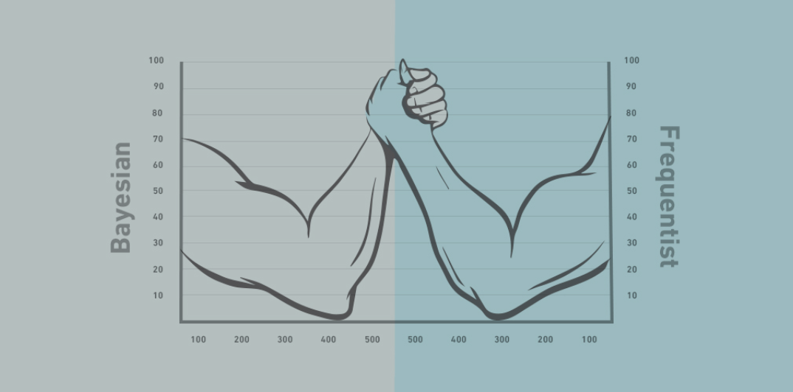
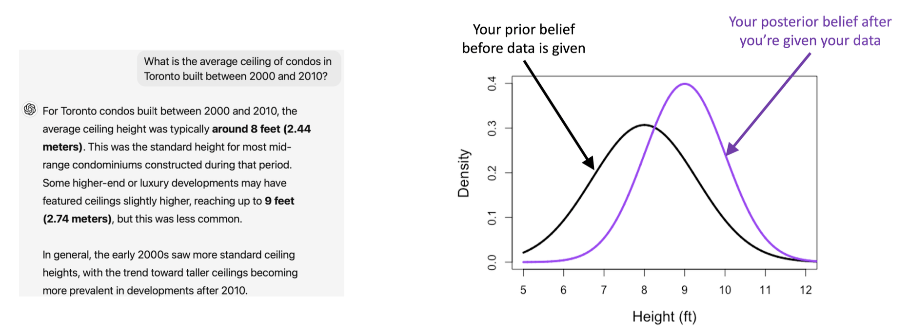
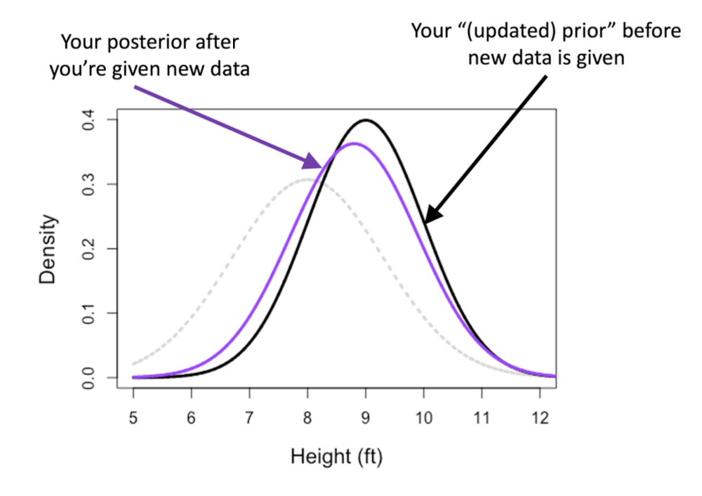
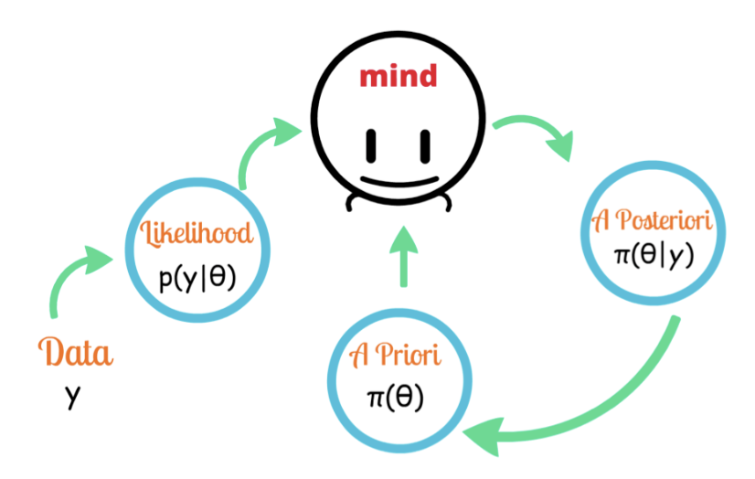
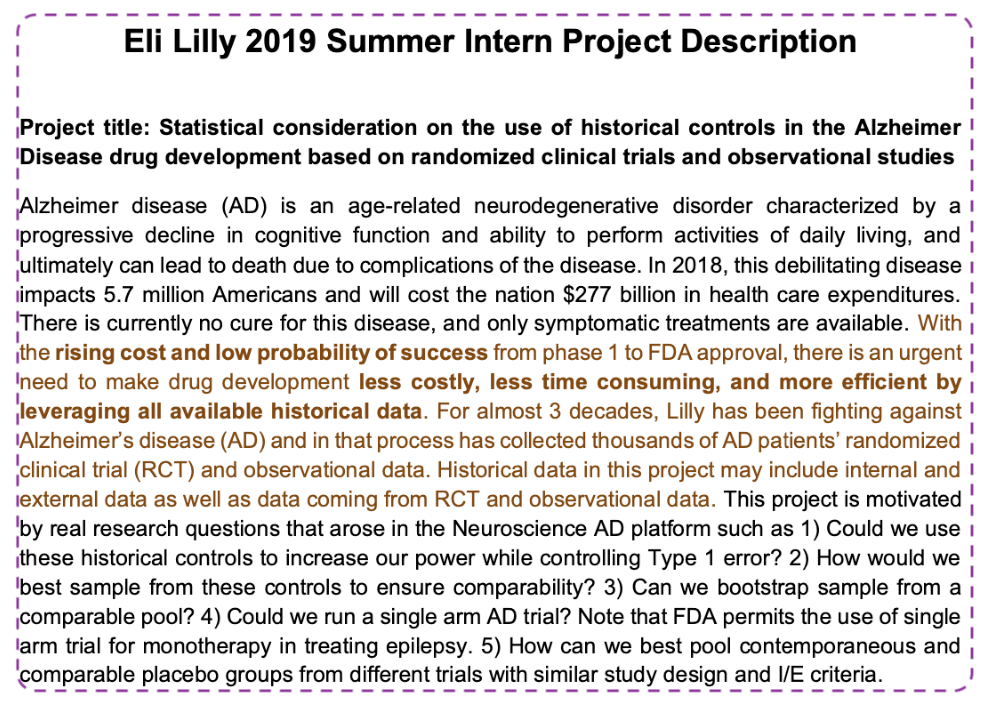
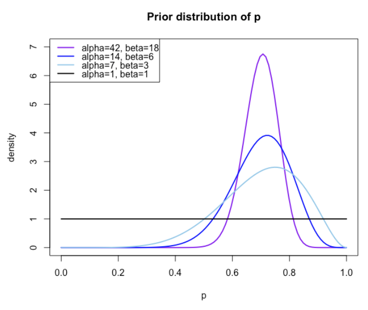
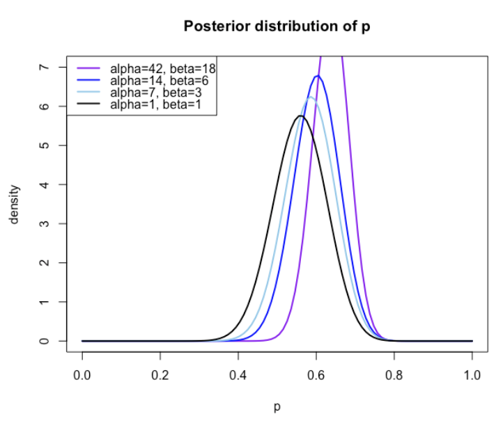
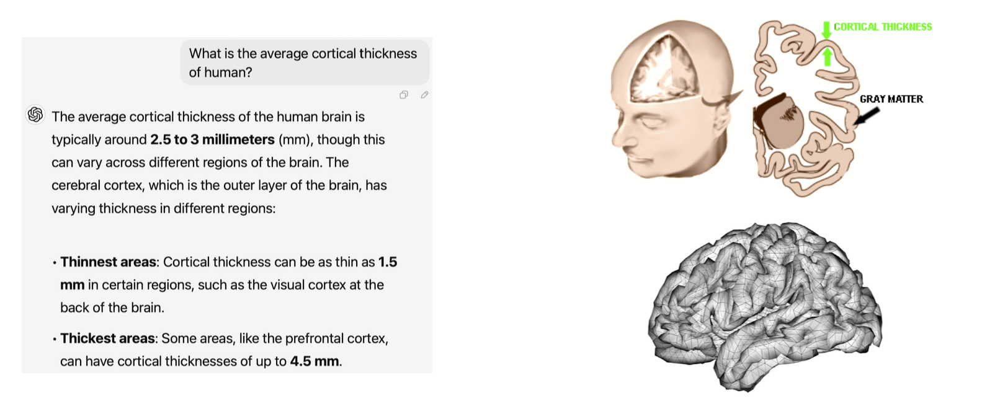

## Table of Contents

- Bayesian viewpoint
- Bayesian linear regression
- Modelling considerations
- Variants of priors in Bayesian linear regression

# Bayesian viewpoint

<br> 
<br> 

::: {.slide-footnote}
Want to learn more? STA365: Applied Bayesian Statistics
:::

## Where are we so far

- **Gauss-Markov Theorem:**
  - compares linear, unbiased estimators
  - does not depend on specific DGPs.
  
- **Maximum likelihood:**
  - allows biased (yet asymptotically unbiased) estimators to be compared (asymptotically) under specific DGPs.
  
- So far, we were mostly interested in comparing the variance of different estimators that are [(nearly) unbiased]{.maroon}.

- This lecture investigates whether [potentially biased]{.maroon} estimators could be useful.

## Two schools in statistics

[**Frequentist vs Bayesian**]{.maroon}

{fig-align="center" width="100%"}

- Competitive or complimentary?

## Bayesian viewpoint

- This course focuses on [frequentist (i.e. classical)]{.maroon} view on parameters and does not cover Bayesian statistics in details. However, some comparisons are warranted.

<br> 

- Frequentists view parameters as fixed, unknown [constants]{.maroon}.

::: {style="text-align: center;"}
*“I use data only to estimate parameters.”*
:::

- Bayesians assign [subjective belief]{.maroon} on the parameters using additional probability distributions.

::: {style="text-align: center;"}
*“I [believe]{.maroon} the probability that $\mu$ is between -3 and 4 is 70%”*
:::

## Bayesian viewpoint

**Example:** ‘your belief’ on average condo ceilings in Toronto

{fig-align="center" width="100%"}

- prior belief ($\mu\approx 8$) + data ($y_1,\ldots,y_{20}$) $\Rightarrow$ new belief ($\mu\approx 9.2$)

## Bayesian viewpoint

**Example:** ‘your updated belief’ when you’re given ‘new’ dataset

{fig-align="center" width="100%"}

- prior belief ($\mu\approx 9.2$) + new data ($y_{21},\ldots,y_{30}$) $\Rightarrow$ new belief ($\mu\approx 9.05$)

  (The prior belief is from initial prior + $y_1,\ldots,y_{20}$.)

## Bayesian viewpoint²

:::: {.columns}
::: {.column width="60%"}
- Given your DGP specified,
  - **Frequentist:** use data only
  - **Bayesian:** use data + your prior knowledge

:::
::: {.column width="40%"}
{fig-align="center" width="100%"}
:::
::::


- Bayesians use data to [update]{.maroon} the subjective belief of the parameter. Based on this ‘updated distribution (belief)’, one can predict the best location of the parameter (e.g. mean of the posterior distribution).

::: {style="text-align: center;"}
*“I have prior belief on parameters. Once data is given, I use it to update my belief. Based on my updated belief, I choose the most probable value.”*
:::

::: {.slide-footnote}
<small>² Figure adapted from https://freshbiostats.wordpress.com/</small>
:::

## Practicality of Bayesian modeling

:::: {.columns}
::: {.column width="60%"}
- Bayesian methods allow researchers to incorporate data from previous studies, expert knowledge, or historical data into the current trial.
- This can be useful in areas where large (historical) datasets are available or where ethical concerns limit the size of new trials (e.g., rare diseases).
- In frequentist’s, statistical decision is made solely based on the data you collected.

:::
::: {.column width="40%"}
{fig-align="center" width="1000%"}
:::
::::

## Bayesian viewpoint

- By viewing parameter as a random variable (that reflects subjective belief), one can use [**Bayes Theorem**]{.maroon} to show that

$$
p(\text{parameter}\mid\text{data})=\frac{p(\text{data}\mid\text{parameter})\times p(\text{parameter})}{p(\text{data})}.
$$

  where $p$ denotes for any probability distribution function (pdf) (or probability mass function (pmf)).

:::{.fragment}
  - $p(\text{parameter}\mid\text{data})$ is the posterior distribution
  - $p(\text{data}\mid\text{parameter})$ is the likelihood
  - $p(\text{parameter})$ is the prior
  - $p(\text{data})$ is a constant that can be ignored. It is sufficient to get a valid form of the likelihood and prior to have a posterior.
  
::: 

## Bayesian Viewpoint

[**Bayes Rule**]{.maroon} 

- Both frequentist and Bayesian start modeling with specifying a DGP for the data, which naturally leads to a likelihood. For example,

$$y_i\overset{\text{i.i.d.}}{\sim}N(\mu,\sigma^2)\tag{1}$$

1. Frequentists use this information to estimate parameters (e.g., $\mu$ and $\sigma^2$ in this example).

2. Bayesian uses additional probability models for parameters to reflect subjective belief. For example,

$$\mu\sim N(\theta,\tau^2)\tag{2}$$

Then use (1) and (2) to update your belief with data (posterior).

## Bayesian Viewpoint

[**Marginalized model**]{.maroon}

- When $\mathbf y=\mu \cdot \mathbf 1+\boldsymbol\epsilon$ with $\boldsymbol\epsilon\sim MVN(0,\sigma^2I)$ with and $\mu\sim N(\theta,\tau^2)$, and assuming that $\mu$ and $\epsilon$s are independent,

$$
\begin{aligned}
E[\mathbf y]&=E[E[\mathbf y\mid\mu]]=E[\mu \cdot \mathbf1]=\theta \cdot \mathbf1\\
\operatorname{Var}[\mathbf y]&=\operatorname{Var}(E[\mathbf y\mid\mu])+E(\operatorname{Var}[\mathbf y\mid\mu])\\
&=\operatorname{Var}(\mu \cdot \mathbf1)+E(\sigma^2I)\\
&=\tau^2\mathbf1\mathbf1^T+\sigma^2I.
\end{aligned}
$$

- Does $\mathbf y$ have the independent entries now?

$$\operatorname{Var}(\mathbf y)=\begin{pmatrix}
\tau^2+\sigma^2&\tau^2&\cdots&\tau^2\\
\tau^2&\tau^2+\sigma^2&\cdots&\tau^2\\
\vdots&\vdots&\ddots&\vdots\\
\tau^2&\tau^2&\cdots&\tau^2+\sigma^2
\end{pmatrix}\ \Rightarrow\ \text{Not independent anymore}.$$

## Bayesian viewpoint

- With $y_i\overset{\text{i.i.d.}}\sim N(\mu,\sigma^2)$ with $\mu\sim N(\theta,\tau^2)$, where $\sigma^2,\theta,\tau^2$ are fixed,

$$
\begin{aligned}
p(\mu\mid\mathbf y)&\propto\underbrace{p(\mathbf y\mid\mu)}_{\text{likelihood}}\times\underbrace{p(\mu)}_{\text{prior}}\\
&\propto\exp\!\left[-\frac{n}{2\sigma^2}(\mu^2-2\bar y\mu)\right]\exp\!\left[-\frac{(\mu-\theta)^2}{2\tau^2}\right]\\
&\propto\exp\!\left[-\frac12\left(\frac n{\sigma^2}(\mu^2-2\bar y\mu)+\frac1{\tau^2}(\mu^2-2\theta\mu+\theta^2)\right)\right]\\
&\propto\exp\!\left[-\frac12\left(\left(\frac n{\sigma^2}+\frac1{\tau^2}\right)\mu^2-2\left(\frac{n\bar y}{\sigma^2}+\frac\theta{\tau^2}\right)\mu+\frac{\theta^2}{\tau^2}\right)\right]\\
&\propto\exp\!\left[-\frac1{2b^2}(\mu-a)^2\right]
\end{aligned}
$$

where

$$a=\frac{\sigma^2\theta+n\tau^2\bar y}{\sigma^2+n\tau^2},\qquad b^2=\frac{\sigma^2\tau^2}{\sigma^2+n\tau^2}.$$

- Q: what is ‘the’ probability distribution that is defined on $\mathbb R$ and has the pdf shown above?

## Bayes estimator

- When $y_i\overset{\text{i.i.d.}}\sim N(\mu,\sigma^2)$ with a prior $\mu\sim N(\theta,\tau^2)$, where $\sigma^2,\theta,\tau^2$ are fixed, the posterior distribution of $\mu$ given data is

$$\mu\mid\mathbf y\sim N\!\left(\frac{\sigma^2\theta+n\tau^2\bar y}{\sigma^2+n\tau^2},\frac{\sigma^2\tau^2}{\sigma^2+n\tau^2}\right)$$

  so that a reasonable estimator of $\mu$ would be its posterior mean:

$$\hat\mu_{\text{bayes}}=\frac{\sigma^2\theta+n\tau^2\bar y}{\sigma^2+n\tau^2}.$$

:::{.fragment}
- Note that $\hat\mu_{\text{bayes}}$ is a [biased estimator]{.maroon} of $\mu$ because

$$E[\hat\mu_{\text{bayes}}]=E\!\left[\frac{\sigma^2\theta+n\tau^2\bar y}{\sigma^2+n\tau^2}\right]=\frac{\sigma^2}{\sigma^2+n\tau^2}\theta+\frac{n\tau^2}{\sigma^2+n\tau^2}\mu\ne\mu$$

unless $\theta=\mu$.

::: 

## Bayes estimator

- In this case, [posterior mean]{.maroon} is the weighted average of [sample mean]{.maroon} (from your data) and [prior mean]{.maroon} (from your ‘belief’)

$$\frac{\sigma^2\theta+n\tau^2\bar y}{\sigma^2+n\tau^2}=\underbrace{\frac{\sigma^2}{\sigma^2+n\tau^2}}_{w_1}\theta+\underbrace{\frac{n\tau^2}{\sigma^2+n\tau^2}}_{w_2}\bar y.$$

- Notes

  - As $n\to\infty$ it means $w_1\to0$ and $w_2\to1$, implying that posterior mean $\approx$ sample mean. If $n$ is large, the posterior mean is less affected by the prior mean.
  - If $\tau^2\gg\sigma^2$ for a fixed $n$, then $w_1\approx0$ and $w_2\approx1$, implying that posterior mean is affected more by your data.
  - If your prior mean is 0, then the posterior mean is not affected by your prior mean but prior variance.

## Simulation

:::: {.columns}
::: {.column width="48%"}
- When $y_i\overset{\text{i.i.d.}}\sim N(3,5^2)$, we compare:
  - $\hat\mu_1$ = sample mean
  - $\hat\mu_2$ = posterior mean with $\mu\sim N(3,10^2)$
  - $\hat\mu_3$ = posterior mean with $\mu\sim N(3,1^2)$
- All estimators are unbiased because prior mean is correctly specified by the population mean.
- $\hat\mu_3$ is the best in reducing the variance because prior variance was the lowest.

:::
::: {.column width="52%"}

```{webr}
set.seed(442)
mu1 = mu2 = mu3 = vector()
for (sim in 1:10000){
  y = rnorm(10, mean=3, sd=5)
  mu1[sim]=mean(y)
  mu2[sim]=(25*3+sum(y)*100)/(25+10*100)
  mu3[sim]=(25*3+sum(y)*1)/(25+10*1)
}
c(mean(mu1), mean(mu2), mean(mu3))
c(var(mu1), var(mu2), var(mu3))
```
:::
::::

## Simulation

:::: {.columns}
::: {.column width="48%"}
- When $y_i\overset{\text{i.i.d.}}\sim N(3,5^2)$, we compare:
  - $\hat\mu_1$ = sample mean
  - $\hat\mu_2$ = posterior mean with $\mu\sim N(0,10^2)$
  - $\hat\mu_3$ = posterior mean with $\mu\sim N(0,1^2)$
- $\hat\mu_2$, $\hat\mu_3$ are biased as prior mean isn’t specified correctly as the population mean.
- $\hat\mu_3$ is still the best in reducing the variance.
  - Is it meaningful, considering huge bias?
  
:::

::: {.column width="52%"}
```{webr}
set.seed(442)
for (sim in 1:10000){
  y=rnorm(10, mean=3, sd=5)
  mu1[sim]=mean(y)
  mu2[sim]=(sum(y)*100)/(25+10*100)
  mu3[sim]=(sum(y)*1)/(25+10*1)
}
c(mean(mu1), mean(mu2), mean(mu3))
c(var(mu1), var(mu2), var(mu3))
```
:::
::::

## Bayesian viewpoint on frequentist methods

- The parameter estimates, e.g. the sample mean, could be interpreted by the [posterior mean]{.maroon} with a [non-informative prior]{.maroon}³:

$$\mu\sim\operatorname{Unif}(-\infty,\infty)\ \Rightarrow\ p(\mu)=1.$$

  We don’t have any prior information about $\mu$ — we don’t assume anything.

:::{.fragment}  
- In this case,

$$p(\mu\mid\mathbf y)\propto p(\mathbf y\mid\mu)\times p(\mu)\propto\exp\!\left[-\frac1{2\sigma^2}\sum_{i=1}^n(y_i-\mu)^2\right]\times1\propto\exp\!\left[-\frac n{2\sigma^2}(\mu-\bar y)^2\right]$$

  so that the posterior mean is just the sample mean.
:::

::: {.slide-footnote}
<small>³ Of course $\operatorname{Unif}(-\infty,\infty)$ is not a valid probability distribution as it does not integral is $\infty$ (not 1). However, it is considered as a valid prior in constructing the posterior distribution.</small>
:::


## Examples from non-normal DGP

- **Example:** You conduct a poll of UofT students and ask “Do you have an Instagram account?” Of the $n=50$ randomly chosen students you survey, $x=28$ say “yes.” Let $\theta$ be the true proportion of students at UofT who would say yes.

<br> 

:::{.fragment}
- When $y_i$ is the response from the $i$th student, then a possible DGP is

$$y_i\sim\operatorname{Bernoulli}(p)$$

- One way to use prior for $p\in(0,1)$ is the $\operatorname{Unif}(0,1)$ that does not assume anything.
::: 

## Examples from non-normal DGP

:::: {.columns}
::: {.column width="60%"}

- Suppose that, based on the University of Waterloo’s comprehensive survey results, you have a reasonable belief that $p$ will be around 0.7. One possible prior is the Beta distribution, defined on (0,1). It depends on two parameters $\alpha$ and $\beta$ and

$$E(X)=\frac\alpha{\alpha+\beta}\quad\text{and}\quad\operatorname{Var}(X)=\frac{\alpha\beta}{(\alpha+\beta+1)(\alpha+\beta)^2}$$

  - Note that $\operatorname{Unif}(0,1)\equiv\operatorname{Beta}(1,1)$
  
:::
::: {.column width="40%"}

{fig-align="center" width="100%"}
:::
::::

- Therefore, we set a prior $p\sim\operatorname{Beta}(\alpha,\beta)$.
- We may choose $\alpha$ and $\beta$ flexibly that the prior mean is around 0.7 and the variance depends on the degree of your belief.
  - For example, $\operatorname{Beta}(42,3)$ is a much stronger prior than $\operatorname{Beta}(7,3)$.

## Examples from non-normal DGP

:::: {.columns}
::: {.column width="60%"}

- It can be shown that when $y_i\overset{\text{i.i.d.}}\sim\operatorname{Bernoulli}(p)$ and $p\sim\operatorname{Beta}(\alpha,\beta)$, then

$$p\mid\mathbf y\sim\operatorname{Beta}\!\left(\alpha+\sum_{i=1}^ny_i,\ \beta+n-\sum_{i=1}^ny_i\right).$$
  
:::
::: {.column width="40%"}

{fig-align="center" width="100%"}
:::
::::

- Still, the Bayes estimator reflects (i) your prior mean and (ii) sample mean, and the prior variance reflects how much weights you put on priors.


## Drawbacks and counterpoints

- **Subjectivity in prior selection**
  - “Why should I trust [your prior]{.maroon}”?
  - Strong priors usually reduce variance, but it comes with increased biases.

- **Computational burden**
  - Examples covered in this lecture are relatively ‘simple’ so that your posterior is given by normal distribution with a closed-form estimates.
    - For example: Normal DGP + [Normal]{.maroon} prior on $\mu$ $\Rightarrow$ [Normal]{.maroon} posterior
    - For example: Bernoulli DGP + [Beta]{.maroon} prior on $p$ $\Rightarrow$ [Beta]{.maroon} posterior
  - In many cases, it isn’t.
  - Bayesian methods often require intensive computational techniques like Markov Chain Monte Carlo (MCMC), which can be [slow and difficult to implement]{.maroon}. 

- It requires knowledge of probability and statistics (and programming) that are beyond undergraduate level.
  - Not straightforward as `glm()`

## Drawbacks and counterpoints

- **Bayesian CLT**: under general conditions, when $y_1,\ldots,y_n\overset{\text{i.i.d.}}\sim p(\cdot\mid\theta)$ are i.i.d and $n\to\infty$,

$$p(\theta\mid\mathbf y)\sim \mathcal{AN}(\hat\theta_{\text{mle}},I(\theta))$$

  More and more data points will dominate prior and the posterior mean $\approx$ MLE.
  
- [Weakly informative (or even non-informative) priors]{.maroon} can be used when no clear prior knowledge is available.

- Advances in computational power and the development of efficient algorithms make Bayesian methods more accessible.

## Knowledge Check

<br> 
<br>
<br> 

1. Both Bayesian and Frequentist approaches begin by specifying a data-generating process. What is the main difference between how frequentists and Bayesians treat unknown parameters? How does this affect the interpretation of their estimates?


## Knowledge Check

<br> 
<br>
<br> 

2. Suppose two researchers analyze the same dataset using the same likelihood, but obtain different posterior estimates. How could this happen? Under what circumstances would you expect their estimates to become more similar?

## Knowledge Check

<br> 
<br>
<br> 

3. We saw that introducing a prior can reduce the variance of an estimator while introducing bias. Does this necessarily mean the Bayesian estimator is worse than an unbiased estimator? Explain your reasoning.

# Bayesian linear regression

## Bayesian linear regression

- Revisiting the linear regression,

$$y_i=\mathbf x_i^T\boldsymbol\beta+\epsilon_i\qquad\text{where}\qquad\epsilon_i\overset{\text{i.i.d.}}\sim N(0,\sigma^2)$$

- Suppose for now that $\sigma^2$ is known and $\mathbf y$ as well as each covariate are standardized (so that we don’t need $\beta_0$). The only parameters we have here are $\beta_1,\ldots,\beta_p$ and we put our ‘prior’ by

$$\beta_j\overset{\text{i.i.d.}}\sim N(0,\tau^2)\qquad\text{or, equivalently,}\qquad\boldsymbol\beta\sim MVN(0,\tau^2I)$$

:::{.fragment}
- Intuitively, we make a prior that the regression parameters $\beta_1,\ldots,\beta_p$ are mostly centered around 0.

  - Q: How does the normal curve look like when $\tau^2$ increases to $\infty$?
  - Q: And what does it imply?
  
::: 

## Bayesian linear regression

- The normal prior in the previous slide gives us

$$p(\boldsymbol\beta)\propto\exp\!\left(-\frac1{2\tau^2}\boldsymbol\beta^T\boldsymbol\beta\right)=\exp\!\left(-\frac1{2\tau^2}\sum_{j=1}^p\beta_j^2\right)$$

:::{.fragment}
- Therefore, the posterior of $\boldsymbol\beta$ is

$$\begin{aligned}
p(\boldsymbol\beta\mid\mathbf y)&\propto\exp\!\left[-\frac1{2\sigma^2}(\mathbf y-X\boldsymbol\beta)^T(\mathbf y-X\boldsymbol\beta)\right]\times\exp\!\left[-\frac1{2\tau^2}\boldsymbol\beta^T\boldsymbol\beta\right]\\
&\propto\exp\!\left[-\frac1{2\sigma^2}(\mathbf y-X\boldsymbol\beta)^T(\mathbf y-X\boldsymbol\beta)-\frac1{2\tau^2}\boldsymbol\beta^T\boldsymbol\beta\right].
\end{aligned}$$

::: 

:::{.fragment}
- Therefore, the maximum a posteriori (Bayes) estimator is $\hat{\boldsymbol\beta}_{\text{bayes}}$ that minimizes

$$(\mathbf y-X\boldsymbol\beta)^T(\mathbf y-X\boldsymbol\beta)+\lambda\boldsymbol\beta^T\boldsymbol\beta\qquad\text{where}\quad\lambda=\sigma^2/\tau^2.$$
::: 

## Bayesian linear regression

[**Observation 1**]{.maroon}

$$(\mathbf y-X\boldsymbol\beta)^T(\mathbf y-X\boldsymbol\beta)+\lambda\boldsymbol\beta^T\boldsymbol\beta\qquad\text{where}\quad\lambda=\sigma^2/\tau^2$$

- Recall the Lagrangian multiplier from multivariable calculus. The $\lambda\boldsymbol\beta^T\boldsymbol\beta$ term corresponds to the penalty that restricts the domain of $\beta_1,\ldots,\beta_p$ by

$$\sum_{j=1}^{n}\beta_j^2\le t\qquad\text{for some}\quad t>0$$

  Therefore, Bayesian linear regression naturally prevents the model from overfitting the data, because it’s imposing restrictions about $\beta_j$s being too large. The degree of regularization depends on your prior variance $\tau^2$.

## Bayesian linear regression

[**Observation 2**]{.maroon}

$$(\mathbf y-X\boldsymbol\beta)^T(\mathbf y-X\boldsymbol\beta)+\lambda\boldsymbol\beta^T\boldsymbol\beta\qquad\text{where}\quad\lambda=\sigma^2/\tau^2$$

- Recall AIC and BIC in model selection: find the model $\boldsymbol\beta$ that the following criterion is minimized:

$$\operatorname{AIC}:\operatorname{SSE}(\boldsymbol\beta)+2\times\sum_{j=1}^p I(\beta_j\ne0)$$

$$\operatorname{BIC}:\operatorname{SSE}(\boldsymbol\beta)+\log(n)\times\sum_{j=1}^p I(\beta_j\ne0)$$

  - AIC/BIC prevented overfitting by imposing a [penalty]{.maroon}.
- Bayesian linear regression could be viewed as imposing another form of penalty.

## Bayesian linear regression

[**Observation 3**]{.maroon}

- The Bayes estimator of $\boldsymbol\beta$ is equivalent to

$$\hat{\boldsymbol\beta}_{\text{bayes}}=(X^TX+\lambda I)^{-1}X^T\mathbf y\qquad\text{where}\quad\lambda=\sigma^2/\tau^2$$

- $(X^TX+\lambda I)$ is invertible as long as $\tau<\infty$. (i) Multicolinearity or (ii) $p>n$ isn’t a big issue in Bayesian linear regression.
- It is biased in general, unless $\boldsymbol\beta=0$ or $\tau^2=\infty$.

$$E[\hat{\boldsymbol\beta}_{\text{bayes}}]=(X^TX+\lambda I)^{-1}X^TX\boldsymbol\beta\ne\boldsymbol\beta$$

  but what does $\tau^2=\infty$ mean?

## GLM with normal prior

- **Logistic regression with a logit link**: the likelihood is specified by

$$\begin{aligned}
L(\boldsymbol\beta\mid\mathbf y)&=\prod_{i=1}^n\left(\frac{e^{\mathbf x_i^T\boldsymbol\beta}}{1+e^{\mathbf x_i^T\boldsymbol\beta}}\right)^{y_i}\left(\frac1{1+e^{\mathbf x_i^T\boldsymbol\beta}}\right)^{1-y_i}\\
&\propto\exp\!\left[\sum_{i=1}^n\left\{y_i(\mathbf x_i^T\boldsymbol\beta)-\log(1+e^{\mathbf x_i^T\boldsymbol\beta})\right\}\right].
\end{aligned}$$

:::{.fragment}
- The posterior of $\boldsymbol\beta$, when given a prior $\boldsymbol\beta\sim MVN(0,\tau^2I)$ would be

$$p(\boldsymbol\beta\mid\mathbf y)\propto L(\boldsymbol\beta\mid\mathbf y)\times p(\boldsymbol\beta)\propto\exp\!\left[\sum_{i=1}^n\left\{y_i(\mathbf x_i^T\boldsymbol\beta)-\log(1+e^{\mathbf x_i^T\boldsymbol\beta})\right\}-\frac1{2\tau^2}\boldsymbol\beta^T\boldsymbol\beta\right]$$

::: 

:::{.fragment}
- Therefore $\hat{\boldsymbol\beta}_{\text{bayes}}$ is obtained by minimizing

$$-\sum_{i=1}^n\left\{y_i(\mathbf x_i^T\boldsymbol\beta)-\log(1+e^{\mathbf x_i^T\boldsymbol\beta})\right\}+\frac1{2\tau^2}\boldsymbol\beta^T\boldsymbol\beta$$
::: 

No closed form solution, which makes things more complicated.

## Modelling considerations

[**What if our prior is incorrect?**]{.maroon}

- Recall that for $y_i\overset{i.i.d.}{\sim}N(\mu,\sigma^2)$ and $\mu\sim N(\theta,\tau^2)$, the posterior mean is

$$
\hat\mu_{\text{bayes}} = \frac{\sigma^2}{\sigma^2+n\tau^2}\theta+\frac{n\tau^2}{\sigma^2+n\tau^2}\bar y.
$$

- If $\theta$ is far from the true $\mu$, a **small prior variance** $\tau^2$ can pull our estimate toward the wrong value.
- A **larger prior variance** makes the estimate less sensitive to the prior mean; as $n$ increases, the data receive more weight.
- **Remedy:** Perform a *prior sensitivity analysis*: compare posterior estimates under several reasonable prior means and variances.

## Modelling considerations

[**What if the likelihood is misspecified?**]{.maroon}

- In Bayesian inference, we specify **both** a model for the data (the likelihood) and a prior for the parameters.
- For example, suppose we model counts using

$$Y_i\mid\lambda_i\sim\operatorname{Poisson}(\lambda_i),\qquad E(Y_i\mid\lambda_i)=\operatorname{Var}(Y_i\mid\lambda_i)=\lambda_i.$$

- If the counts are **overdispersed**, a well-chosen prior for $\lambda_i$ does not, by itself, fix an inappropriate Poisson sampling model.
- **Remedy:** Reconsider the data-generating process; for example, a negative binomial likelihood may be more appropriate.

## Modelling considerations

[**Posterior Predictive Checks**]{.maroon}

- How can we assess whether our fitted Bayesian model describes the observed data reasonably well?
- Generate replicated data from the **posterior predictive distribution**:

$$p(\mathbf y^{\mathrm{rep}}\mid\mathbf y)=\int p(\mathbf y^{\mathrm{rep}}\mid\boldsymbol\theta)\,p(\boldsymbol\theta\mid\mathbf y)\,d\boldsymbol\theta.$$

- Compare features of the replicated datasets with the observed data (e.g., mean, variance, proportion of zeros).
- If the model consistently produces much less variation than the observed counts, it may not capture the data-generating process.

**Note:** Posterior predictive checks can reveal lack of fit; they do not prove a model is correct.

## Modelling considerations

[**Choosing and evaluating a prior**]{.maroon}

- The prior affects how strongly the data are regularized. For regression coefficients:

  - A **normal prior** centered at zero gives an $L_2$ penalty (ridge-type estimation).
  - A **Laplace prior** centered at zero gives an $L_1$ penalty (lasso-type estimation).
- Consider whether the prior reflects reasonable knowledge about the parameters and how much shrinkage is appropriate.

- **Remedy:** Compare sensible priors and assess whether substantive conclusions change.

:::{.fragment}
**Questions to ask before interpreting a Bayesian model:**

1. Is the likelihood appropriate for the response and its variability?
2. How sensitive are the results to the prior assumptions?
3. Does the fitted model reproduce important features of the observed data?
::: 

# Variants of priors in Bayesian linear regression

## 1. Independent non-Gaussian priors on $\boldsymbol\beta$

- Your prior on $\boldsymbol\beta$ doesn’t need to be normal. Consider a prior that $\beta_j$s are independent and

$$p(\beta_j)=\frac1{2\tau}\exp\!\left(-\frac1\tau|\beta_j|\right)$$

  which leads to $p(\boldsymbol\beta)\propto\exp\left(-\frac1\tau\times\sum_{j=1}^p|\beta_j|\right)$.

- You still impose a prior that each of $\beta_j$s have mean 0, but with a different distributional form.
  - Q: Would it make a huge difference?

## 1. Independent non-Gaussian priors on $\boldsymbol\beta$

- The posterior of $\boldsymbol\beta$ is

$$\begin{aligned}
p(\boldsymbol\beta\mid\mathbf y)&\propto\exp\!\left[-\frac1{2\sigma^2}(\mathbf y-X\boldsymbol\beta)^T(\mathbf y-X\boldsymbol\beta)\right]\times\exp\!\left[-\frac1\tau\sum_{j=1}^p|\beta_j|\right]\\
&\propto\exp\!\left[-\frac1{2\sigma^2}(\mathbf y-X\boldsymbol\beta)^T(\mathbf y-X\boldsymbol\beta)-\frac1\tau\sum_{j=1}^p|\beta_j|\right].
\end{aligned}$$

- Therefore, the Bayes estimator where $p(\boldsymbol\beta\mid\mathbf y)$ is maximized is the $\boldsymbol\beta$ value that minimizes

$$(\mathbf y-X\boldsymbol\beta)^T(\mathbf y-X\boldsymbol\beta)+\lambda\sum_{j=1}^p|\beta_j|\qquad\text{where}\quad\lambda=2\sigma^2/\tau$$

- This becomes a LASSO problem, still a form of [penalized regression that prevents overfitting]{.maroon}.

## 2. Non-independent Gaussian priors on $\boldsymbol\beta$

**Example:** Cortical thickness

{fig-align="center" width="100%"}

- Two types of prior information:
  - [average cortical thickness]{.maroon} $\approx2.5$mm
  - [spatial dependencies]{.maroon}: two nearby vertices would have similar cortical thickness values.

## 2. Non-independent Gaussian priors on $\boldsymbol\beta$

- If $\boldsymbol\beta=(\beta_1,\ldots,\beta_V)^T$ parametrizes the average cortical thickness at each $v$, a possible prior that incorporates both type of prior information would be

$$\begin{pmatrix}\beta_1\\\beta_2\\\vdots\\\beta_V\end{pmatrix}\sim MVN\!\left(\begin{pmatrix}2.5\\2.5\\\vdots\\2.5\end{pmatrix},\Sigma\right)$$

  where $\Sigma[j,k]=\sigma^2\exp(-\phi d_{jk})$ and $d_{jk}$ is the distance between two vertices $j$ and $k$.
  
  - $\phi>0$ controls the degree of spatial correlation.
  - If $d_{jk}$ is large, our prior specifies that the correlation between $\beta_j$ and $\beta_k$ is low.
  - If $d_{jk}$ is nearly 0, our prior specifies that the correlation between $\beta_j$ and $\beta_k$ is nearly 1.
  
- In practice, $\phi$ is unknown $\Rightarrow$ specify additional prior on $\phi$!

## Summary

- **Bayesian inference** combines observed data (likelihood) with prior information to obtain a posterior distribution:

  $$p(\boldsymbol\theta\mid\mathbf y)\propto p(\mathbf y\mid\boldsymbol\theta)p(\boldsymbol\theta).$$

- **Bayesian estimators** can introduce bias but may reduce variance, depending on the choice of prior.

- **Bayesian linear regression** connects naturally to regularization:
  - Normal priors lead to $L_2$ penalties (**ridge regression**).
  - Laplace priors lead to $L_1$ penalties (**lasso regression**).

- **Prior assumptions matter:** the choice and strength of a prior affect parameter estimates, particularly with small samples.

- **Modelling considerations:** assess prior sensitivity, check the appropriateness of the likelihood, and use posterior predictive checks to evaluate model fit.

**Announcements**: Assignment due tonight on Crowdmark! 

**Next Week**: Random Effects Models